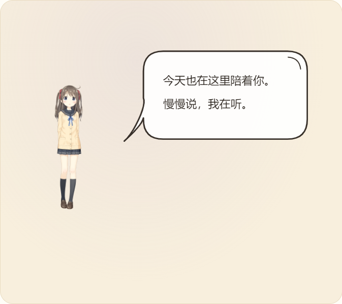
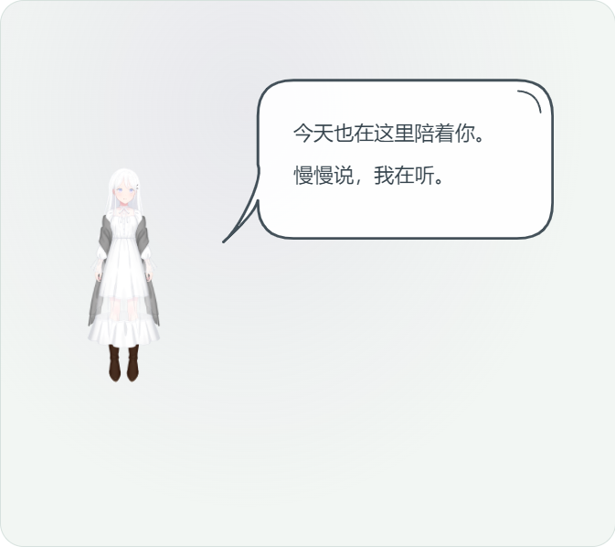

# Yuiro 双角色 UI 与漫画对白样式参考

版本：2026-10-26。适用调试台、独立对白、输入栏、音乐/来源卡及悬浮功能岛。配套 [验收报告](../plan/manga-skins-and-natural-music.md)。

## 设计来源与解释边界

1. 本次用户提供的两张气泡图：分别提取白色外缘与内描边、柔和圆角、框体尾巴一体、局部墨线弧。参考其构造，使用项目内原创SVG几何；不把截图放大拉伸当皮肤。
2. [CLIP STUDIO官方：制作对白框](https://tips.clip-studio.com/ja-jp/articles/863)与[官方漫画工具手册](https://help.clip-studio.com/ja-jp/manual_jp/540_comic/フキダシ【PRO__47_EX】.htm)：框体、尾巴可独立调节，曲线/样条可形成自然尖尾。工程落地选择一条连续轮廓，避免两层半透明接缝。
3. [BanG Dream官方角色页：汐見 蛍](https://bang-dream.com/artist/millsage/shiomi-hotaru/)与[官方millsage资料](https://bang-dream.com/artist/millsage/)：官方检索索引可核对成员身份及“乐坛的天使”称呼；本次正文抓取返回404/503，未声称逐像素提取官方视觉规范。
4. “纯白、神圣、单纯、百合、茉莉”为用户指定的Hotaru主题意图，转换成项目的白花视觉语言，不声明花种为官方角色设定。Hiyori的Neuro风格是本项目的奶油暖色方向，不冒充官方UI。

## 两套皮肤

| 项目 | Hiyori · 奶油星光 `cream` | Hotaru · 百合与茉莉 `lily` |
|---|---|---|
| 情绪 | 温暖、轻巧、亲近 | 洁净、安静、轻盈 |
| 主背景 | #fbf4e6 | #f6f8f8 |
| 主要卡面 | #fffdf7 / 对白白色 | #ffffff |
| 标题区 | #f8efdd | #f2f6f3 |
| 主文字（调试台） | #4a3b2a | #35434c |
| 强调色 | #e09a3e 暖琥珀 | #58776a 灰叶绿 |
| 辅色 | 低饱和蜜桃 | 低饱和灰紫 |
| 边线 | #e9dbc0 | #d6e1dd |
| 装饰 | 少量星光/圆点 | 原创百合尖瓣、茉莉小花、细枝 |
| 夜间 | 暖深棕 | 蓝灰底、银绿高光 |

**切换规则**：UI页“角色 UI 风格”默认随角色自动，Hiyori→cream，Hotaru→lily。可手动固定任一皮肤；固定外观不改当前角色，不修改声音、LLM或收藏。日间/夜间、对白表现、字号/排版/位置是独立设置。局部自选文字色优先于皮肤，切换不覆盖用户的其他显示偏好。

这些是设备级外观偏好；本轮并未将每项布局存成两份角色配置。自动映射解决角色视觉切换，保持此前角色Runtime隔离。

## 漫画对白框

- **柔白双描边**：白色外沿+细内轮廓，整体清淡；柔化矩形感，适合多数桌面。
- **漫画墨线**：略强的墨色轮廓，顶部一条短弧形成笔触；不做随机抖动或每帧变化。
- 共同原则：单一闭合轮廓包含弯曲尖尾；尾巴朝向模型所在一侧；描边以实际DIP计算，不随文字框非等比拉伸。短文留白充足，长文限定高度并滚动，不无限扩大遮挡角色。
- “试用漫画曲线预设”设置约28 DIP尖尾、30 DIP圆角、24 DIP内边距、17 DIP字号。用户仍能调整宽度、行高、描边、尖尾、位置和透明度。
- 柔白笔触最细约1.3 DIP、墨线最细约2.2 DIP；旧的0描边配置在新漫画渲染中使用对应基础线宽。
- 半透明度应用于整组框体/边线，避免框体和尾巴叠加处变深；不在文字上叠加毛玻璃滤镜。
- 关闭按钮默认淡出，悬停/键盘聚焦出现；不让常驻“×”破坏外轮廓。
- 保留无背景单曲线模式，保持一条开放贝塞尔连接与原有短线距离/弯曲设置；该模式不渲染闭合框和花卉。
- Markdown继续使用既有安全渲染；装饰SVG位于内容区外，不能由模型输出注入。

## 加花约束

- 装饰只占标题空白或气泡角落；不铺满背景，不覆盖按钮、提示、正文和模型面部。
- 花卉/星光为本地SVG，无外部图像请求、无额外图片依赖；`aria-hidden`、`pointer-events:none`，不扩大桌面命中。
- 白花线稿不透明度默认0.6且可调（气泡）/约0.35（标题），不承担状态或选中标识；正文与控件文字必须单独满足可读性。
- 气泡角花可关闭；宽度不足900px隐藏调试台标题花纹。禁止持续飘花、闪烁、粒子和大面积发光。
- 错误/警告/成功仍沿用独立语义色，不以“神圣纯白”抹掉错误提示。
- 滚动条保持细型，闲置隐化，悬停/聚焦可见；不能隐藏真实可滚动能力或键盘焦点。

## 实现位置和后续约束

- `shell/src/shared/uiAppearance.ts`：有界偏好、皮肤解析及面板tokens；`resolveSkin`是唯一角色映射。
- `shell/src/renderer/src/composables/useUiAppearance.ts`：共享缓存、跨窗口同步、同窗口显式`setCharacter`及根节点`data-skin`。
- `shell/src/renderer/src/styles/characterSkins.css`：调试台和输入栏皮肤tokens；不改透明桌宠的窗口背景。
- `shell/src/shared/mangaBubble.ts`：连续轮廓；`ReplySurface.vue`按ResizeObserver尺寸生成SVG。
- `CharacterMotif.vue`：本地原创装饰；`DevApp.vue`、`BracketMenu.vue`和已有结果卡复用皮肤。

新增页面必须优先用tokens，不另写一套白/米白硬编码。不借换肤引入角色资源重载、LLM重建或播放控制。不改变轮廓命中/透明穿透/渐隐/独立窗口的安全和生命周期边界。

## 本次实机截图

Hiyori柔白框：

Hotaru墨线框（也可切柔白）：

两套配色与模型相对预览：

## 2026-10-27：模型优先桌面补充

常用桌面呈现优先选择UI页“模型优先 · 头部对白预设”，保持字号与面板体积克制。对白尽量靠头部右上，SVG尾尖跟随头部；允许利用资源透明留白，但须以现有Alpha保守包络保护可见像素。屏幕边缘避让优先于固定方位。见[真实桌面截图与边界](../plan/model-first-desktop-acceptance.md)。

2026-10-27补充：气泡角花使用独立34 DIP页脚，减少正文可滚动高度以保持整体体积，不与正文叠放。窗口与聊天坞高度、DIP稳定性和角花实测见[修复报告](../plan/window-height-dock-and-corners.md)。

## 2026-10-27：博客式日记与聊天坞

日记采用网络博客的时间/摘要/标签/阅读顺序，不再使用封面、纸张纹理、翻页和装订装饰。参照 [Astro](https://astro.js.cn/) 的内容优先思路与 [Fuwari](https://github.com/saicaca/fuwari) 的博客信息层级，仅参考设计，不引入框架或模板资产。列表轻分隔、正文舒适行距，管理操作折叠，默认原文直存与仅日记保存。

Hiyori 沿用奶油底与温暖强调色；Hotaru 沿用白花底与克制的绿灰强调色；背景、正文、输入、边框均取共享 tokens，深浅主题及原生标题栏同步。聊天坞可调整位置、宽高、圆角、字号、透明度与按钮；受窗口边界约束，适度偏移，避免挤压模型。实机图见[实施报告](../plan/dock-and-blog-diary.md)。
