# 动态资源抽查与表情预览修正

Goal：补两角色实际动画观察证据，避免文件名/缩略图通过就认定语义合适。Scenario：工作台本地预览默认待机、单击短动作、招呼、思考和安抚候选；不应用预览模型、不改角色配置、不发Agent请求。

Architecture Increment：沿用现有工作台与Live2DCanvas；若预览裁剪影响判断，只局部修正头像取景。Tests：六段真实预览采帧、透明边距头像裁剪与空图回退、类型/构建与生产预览复验。DoD：原始帧与限定范围结论落盘，未审定语义保持待验，不自动推广未知动作。

首轮原始帧在avatar-dynamic-preview/，六个资源可加载/动态采样。发现Hotaru头像因模型画布透明边距偏大而位于画面底部且过小，不能据此充分审定哭泣/思考细节；先修正可见alpha范围取景，再补清晰帧。

## 实施与复验

capturePreview的头像路径现先从180×240全身预览读取可见alpha边界，定位轮廓上部，再换算回原始渲染画布取样。只在低分辨率预览读像素，不在动画每帧扫描全分辨率，也不把低分辨率全身图放大成头像。空图安全返回透明头像。表达缩略图缓存改为v3-head，其他动作缓存仍v2，不强制重生成全部动作页。桌宠本体大小、待机与动作映射未改。

修正后六个资源按约15%/50%/90%周期取帧，并观察完整时长+600ms，全部释放until占用；前后配置完整JSON在浏览器内比较相同，仅输出比较结果、不输出配置内容。证据[动态原始结果](avatar-dynamic-preview-after/result.json)，18张帧保存在同目录。主动角色一直Hotaru；Hiyori只在调试台本地舞台预览，没有应用到角色卡。

| 抽查资源 | 观察与限定结论 |
| --- | --- |
| Hiyori Idle#0 | 平静睁眼、轻微姿态变化；完整周期和释放通过。本轮未改用户固定待机设置 |
| Hiyori Idle#6 | 观察到闭眼微笑、双手在胸前的轻快动作，适合作为偏正向互动候选；不意味着其他Idle均适合随机互动 |
| Hotaru Motion#4 | 观察到抬手、微笑挥手，可支持招呼；bye命名不能独自证明所有情境都适用 |
| Hotaru Motion#40 | 手靠近胸前/领口，姿态含蓄；作为思考候选具备动态证据，不证明所有thinking映射均已审定 |
| Hotaru Motion#10 | 低头、目光收敛的低落动作；不能因文件名cry被映射到comfort就认为等价于安抚用户 |
| Hotaru Motion#0 | tear效果资源可加载与释放；有限帧未充分证明眼泪效果强度和安抚适配，保持语义待验 |

不把哭泣/tear自动归入安抚的历史规则视为已通过视觉审定，本轮未擅自覆盖用户表演配置，也未推广未审定动作。模型参数轨迹、完整多角度资源和用户自然度仍需进一步观察。

头像可见alpha范围对比见[crop-comparison.json](avatar-dynamic-preview-after/crop-comparison.json)：同为180×180输出，Hotaru原轮廓y=86–155，修正后y=16–173；Hiyori原y=55–151，修正后y=15–173。该比较用于说明透明留白减少，采帧阶段略有不同，不是人脸识别或主观质量评分。

| 修正前 | 修正后 |
| --- | --- |
|  |  |

验证：Avatar生产函数专项、工作台调度专项、前端typecheck/build通过，新增诊断Ruff与git diff --check通过。后端未改，沿用上一轮1000项回归基线，不伪称本轮重跑。实机只验证六个本地预览资源，未运行麦克风/供应商请求，未取代Hiyori真实麦克风或用户自然度评价。
