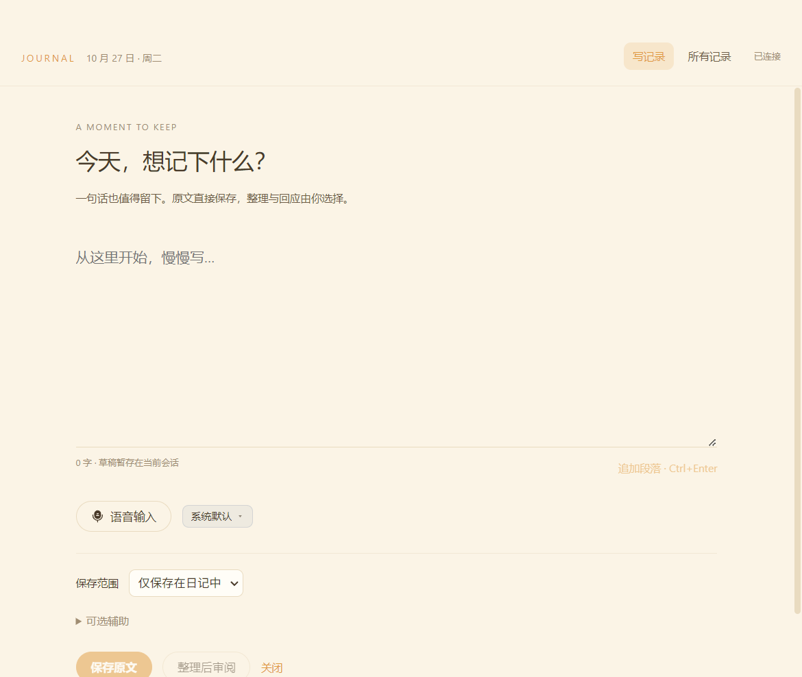
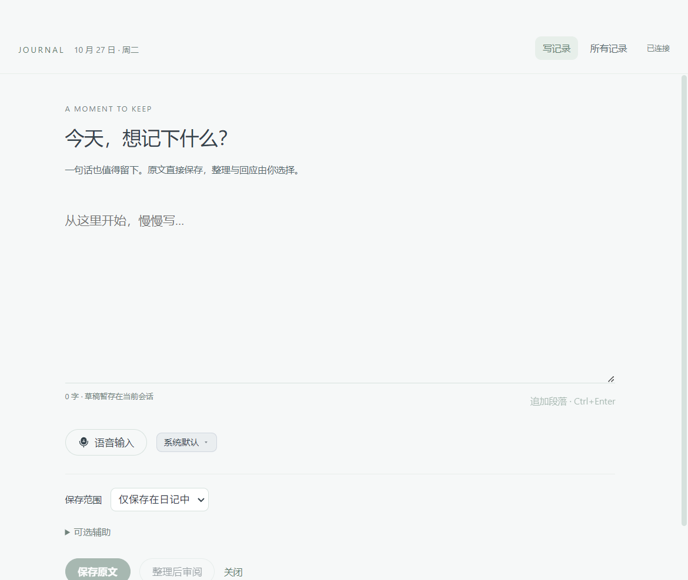
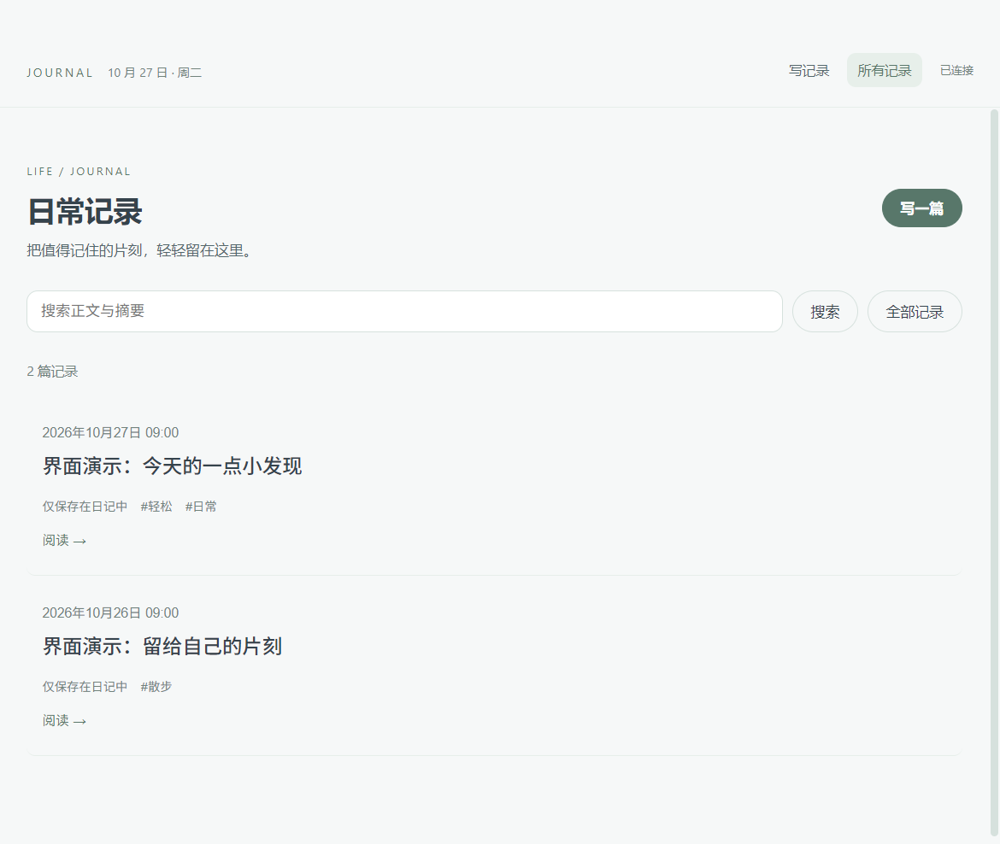

# 聊天坞自定义与博客式日记

日期：2026-10-27。范围：前后端局部调整；不改 Runtime 主线，不实现摄像头。

## 已落地

聊天坞保留宽度、高度、透明度、麦克风/发送按钮，增加左右偏移、离底部偏移（正数上移）、圆角、输入字号。调试台 UI 页热更新，支持整组恢复默认。偏移受模型窗口边界限制，不能把输入条拖到不可操作的位置；向上移动时同步扩大模型底部安全区，因此过大的上移值会挤占模型空间，推荐克制调整。

日记的调试台回顾页与独立记录窗口统一改为“记录 / 所有记录”：时间、摘要、轻量标签的博客条目，点入阅读；移除封面、翻书与实体纸张隐喻。记录页是单一编辑区，Enter换行、Ctrl+Enter追加段落，保存时自动包含尚未追加的输入。归档支持搜索、普通列表分页、原文/可选整理稿阅读。隐私共享、生成回应、删除收在管理区，删除须再次确认。

参考 [Astro 内容驱动网站](https://astro.js.cn/)及 [Fuwari 博客模板](https://github.com/saicaca/fuwari)的内容层级、元信息和主题能力，采用适合本项目的简化布局；未引入 Astro、模板代码或外部视觉素材。日记继续使用 Vue、现有服务与数据库。

## 记录业务修正

- 默认“保存原文”：直接入现有 DiaryService，不调用解构/润色 LLM，不把正文送进 Agent 工具循环；默认仅保存在日记中，共享角色记忆由用户选择。
- “整理后审阅”仍可选。草稿修改后使旧整理结果失效；保存失败保留正文与待确认内容；正在保存时拒绝重复提交和修改。
- 追加等待引擎确认再清空输入；超时保留输入，不自动重试。重连发送现有草稿，不重置正在记录的会话。
- 文字追加使用 literal 标记，“写完了”这类句子不会被当作控制命令。
- 可选低频回应默认关闭，走专用日记通道而非普通聊天工具链，按请求与段落对应，不能覆盖后续段落。
- 换角停止录音、隔离异步 ASR/WS/回应结果，清空旧预览与共享选择；窗口内按角色保留临时草稿。成功保存后删除该角色的临时副本。
- 原文直存以文本前120字生成摘要，避免归档出现大量空标题。没有修改原数据库格式或批量重整历史内容。

## 代码入口

| 职责 | 文件 |
|---|---|
| 聊天坞偏好/边界/热更新 | `shell/src/renderer/src/composables/useChatDockPref.ts`、`App.vue`、`dev/DevApp.vue` |
| 博客归档/阅读 | `shell/src/renderer/src/dev/components/DiaryPanel.vue` |
| 轻量记录、确认与换角隔离 | `shell/src/renderer/src/diary/DiaryApp.vue` |
| 独立窗口大小/原生标题栏配色 | `shell/src/main/index.ts`、`shell/src/preload/index.ts` |
| 保存、草稿修订、重连 | `engine/yuiro/diary/session.py`、`service.py`、`engine/yuiro/main.py` |
| 回归 | `engine/tests/test_diary_recording_flow.py`、`scripts/diag/ui_appearance_test.cjs` |

## 验收证据与边界

2026-10-27 实际 Electron/CDP 检查：

- 独立记录窗口900×760 DIP，两种浅色 skin 实际背景分别为 `rgb(251,244,230)`、`rgb(246,248,248)`，页面宽度没有横向溢出；沿用共享 light/dark tokens 和原生标题栏同步。测试后恢复原主题与角色外观，不修改角色配置。
- 博客归档可打开；下图条目为渲染内存中的明确标记演示数据，未写入数据库，不展示用户真实日记。
- 聊天坞实际设为 X=1000、Y=400，边界检查通过；圆角8px、字号19px即时生效，测试后恢复原偏好。
- 使用非持久化临时草稿实测追加成功、重新连接仍保留、撤回后草稿为空、可选回应默认关闭。没有保存或删除用户日记。
- Python 全量 `929 passed in 57.23s`（含新增5项）；专项日记46项通过；`pnpm typecheck`、`pnpm build`、UI诊断脚本通过。构建仍有现有大型渲染依赖体积提示，未借本轮重构依赖。
- 未开启摄像头/录音做声学验证，未新增 LLM 付费请求；双角色迟到结果隔离由代码路径与回归检查支持，本轮不声称完成新的双角色语音真人验收。

## 仍需明确的限制

草稿保留是引擎会话与当前日记窗口内的临时保留，不是进程崩溃后的磁盘自动恢复。搜索接口本轮沿用现状，最多30条匹配，普通列表才提供加载更多。保存中断后的跨进程幂等键尚未引入；当前只保证会话内防重复，不承诺断电/重启的恰好一次写入。

后续视觉 Tab 仅完成[调研与分阶段方案](vision-tab-evaluation.md)，需另行实施。
