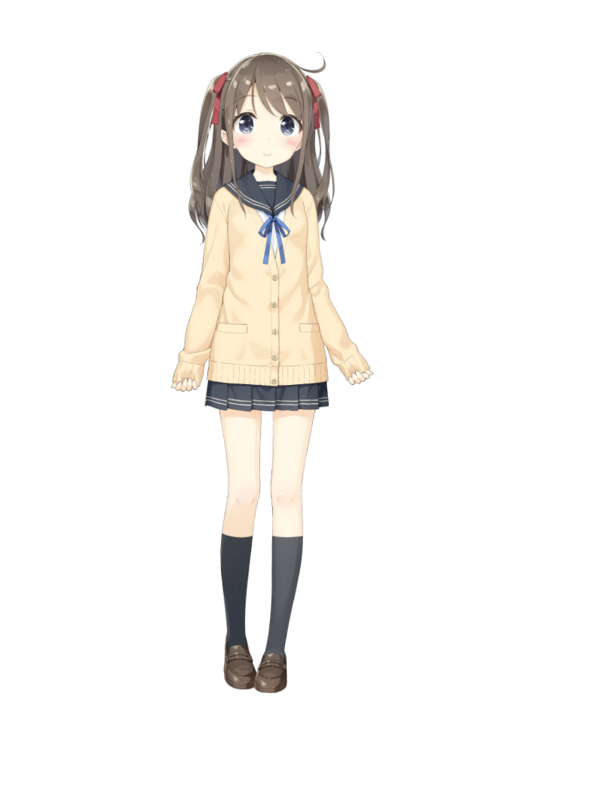
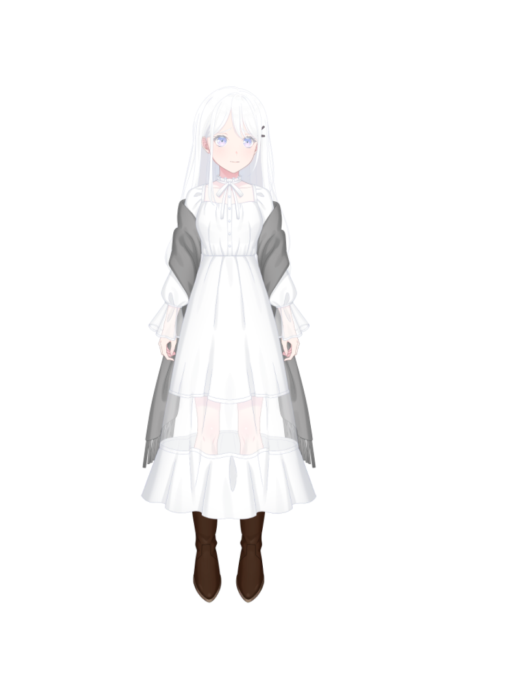

# Live2D 自然交互：方案与实施

最新验收范围见[统一交付审计](live2d-acceptance-audit.md)（2026-11-10）；历史过程不等于最终全部通过。

目标：沿用现有 AvatarRuntime、角色卡和模型清单，让 Hiyori 与 Hotaru 的倾听、思考、说话、打断及待机衔接更自然，保持本地事件驱动、低延迟与角色隔离。

当前状态（2026-11-01）：主要实现与真实双角色合成/换角/语义演出已通过；generation换角工厂遗漏已修复并真实复验。窗口恢复可见后已获得有效短时性能样本与模型画面。持续待机采样和用户自然度确认仍在进行，整体未验收完成。以下保留历史失败与修复过程，最新结论以文末日期更新为准。

## 现状与参考

现有入口由 `AvatarRuntime → avatar:intent → Live2DCanvas` 解析语义槽位；语音播放与口型已有本地链路，待机有独立调度。当前表演结束一律回 neutral，动作池可能连续重复；后端按意图时长仲裁，前端优先读取资源时长，二者可能不一致。上述是源码分析，实际视觉感受须实机评估。

参考 [AIRI Live2D 模型实现](https://github.com/moeru-ai/airi/blob/main/packages/stage-ui-live2d/src/components/scenes/live2d/Model.vue) 的口型与动作更新分工，以及 [Open-LLM-VTuber](https://github.com/Open-LLM-VTuber/Open-LLM-VTuber) 的实时对话与表情交互。参考思路，资源适配和调度按本项目实现；不引入额外服务或复制资产。

## 分阶段任务

1. **资源与基线**：按角色列出表情、动作、时长、语义与实际效果；记录空闲帧耗时、触发到动作开始、播放同步及切换行为。未经实机审定的语义不自动启用。验收：两角色清单独立，缺失槽位安全回退。
2. **衔接与生命周期**：待机去重；记录持续基础表情，一次性动作结束恢复基础表情；新意图、换角及卸载清理定时器，避免旧角色残留。验收：动作结束恢复、覆盖/取消/换角无旧表情，单候选池仍可运行。
3. **状态感知微反应**：以现有 VAD、LLM、实际音频播放和打断事件驱动 listening/thinking/speaking，按角色已审定槽位选择；缺资源就只改变安全可用的表情。短暂状态合并去抖、设冷却，播放结束依据真实本地播放，禁止使用音频发送结束代替。验收：每状态进入退出、打断、慢TTS、失败和换角均不残留，响应延迟记录 P50/P95。
4. **分层仲裁与同步**：明确表情、身体动作、视线、口型所有权及动作完成反馈；逐步统一前后端有效期，不能让低优先级覆盖用户动作，不能由动作覆盖口型。验收：重叠事件回放、动作时长不匹配、取消和多会话隔离。
5. **角色风格与调试**：为两角色配置微动作/幅度/冷却/最近去重，增加触发原因、选中资源、状态与失败原因可观测；可关闭、回退。验收：Hiyori→Hotaru→Hiyori 资源与配置不串，用户能在调试台调整并立即预览。
6. **真实演出验收**：双角色语音、文本、打断、鼠标交互、长时间待机和窗口切换；采集前后 P50/P95、帧率和实录对比。用户对自然度评价作为最终验收，不凭单次自动测试声称最优。

## 边界

不重写 Agent 或 Live2D，不自动引入云端请求、摄像头或不明资源；不以更多动作替代自然性。Generation、会话取消和角色 revision 为硬边界；没有可靠身份信息的现有事件需先补齐契约再用于跨角色异步演出。

## 执行记录

本轮实施阶段2的局部衔接修复：多个待机候选时避免连续重复；持续表情作为模型实例内的基础表情，一次性表演结束恢复它；卸载模型清空基础表情和待机历史。未改变后端仲裁和协议。新增 `scripts/diag/avatar_expression_baseline_test.cjs` 检查持续表情、临时表演、显式回中性及卸载重置；`pnpm typecheck` 和 `pnpm build` 通过。

尚未完成阶段1资源实机标注，也未完成阶段2的换角实机回归与阶段3–6。上述代码测试不等价于完整演出场景测试；没有真实延迟前后基线，暂不宣称速度提升。

### 2026-10-31 持续实施

新增本地 presence 状态转换：VAD进入倾听、ASR/LLM进入思考、实际AudioBufferSource启动进入说话；发送完音频不作为播放结束，真正播完/打断/停播/换角退出。状态作为模型props，倾听/思考/说话时暂停随机待机；思考使用当前清单可用表情，动作进行中不强行覆盖，动作结束按当前状态恢复。组件卸载清理状态保护计时器，等待状态有60秒兜底。

测试脚本已覆盖上述状态和取消转换，typecheck/build通过。当前没有运行中的8200/9222监听，尚未进行本轮实机演出；仍需处理分层仲裁、调试控制、资源审定与双角色体验验收。此记录为进度，不是最终完成声明。

后续同轮验证：启动开发服务器后，两模型在真实Electron/SDK内加载成功，Hiyori枚举8个表情、Hotaru枚举46个表情。受控意图验证了一次性惊讶保持期间的低优先级悲伤不会截断动作占用，到期后恢复新基础情绪；Hotaru解析到自身的 `exp_panic01 → exp_anxiety01`，没有沿用Hiyori表情名。测试后恢复原renderer模型，不写角色卡。原始证据见 `avatar-live-2026-10-31.json`。

新增IntentLease适配器占用保护及优先级/过期/重置测试。此项是前端局部仲裁，不等同于前后端完成回执统一。构建产物直接运行曾有模型网络加载错误，开发服务器路径可用；该发布路径问题仍需排查，不能以开发模式成功代替打包验收。引擎未启动，所以本次不是完整自然语言/语音双角色验收。

### 构建资源与交互控制补充

已修正文件页面下 `/live2d/` 根路径被解析到磁盘根的问题：SDK入口解析为相对构建页面的file URL，角色配置和清单仍使用规范web路径。文件模式不再通过fetch做重复诊断，以SDK加载为准。新增路径回归覆盖构建目录、空格、开发服务器。

构建页面真实复测，两套模型的SDK表情/动作枚举均成功，并运行了临时表情→延迟基础情绪恢复场景，证据 `avatar-built-live-2026-10-31.json`。报告中的loaded字段依据SDK表情枚举非空，error为空是脚本占位，不代表自动读取全部SDK错误；此证据不能代替图像视觉评分或完整安装包验收。

外观页加入“交互状态反应”按角色独立开关。开启时说话开始可选短nod动作，必须有已映射资源和已知时长≤2.5秒，12秒冷却，不覆盖正在进行的显式表演；预览窗口不自动触发。关闭恢复基础表情，停止未来自动状态动作。已开始的短动作仍按原定时长结束。思考/说话反应依旧完全本地，无新LLM调用。

仍待：自动动作的双角色视觉审定、完整播放/打断验收、前后端完成回执统一、状态观测面板及性能分位数；未宣布目标完成。

### 动作回执与状态观测

已接入意图UUID、所属会话与渲染开始/结束/替换取消回执。开始回执将前端实际采用的时长同步给后端（1–60000ms边界）；仅当前意图ID可更新或释放占用，旧意图和其他会话不能释放当前动作。无回执仍保留旧时长兜底。前端在换角期及收到其他非全局会话意图时拒绝应用。协议类型位于 `engine-protocol.ts`。

新增 `engine/tests/test_avatar_receipt.py`，与既有Avatar专项合计13项通过，覆盖实际时长、旧ID、其他会话、持续情绪与上限。前端状态测试、typecheck/build通过。调试台外观卡片增加同模型的当前状态、表情、动作和更新时间，只观测表现数据，预览组件不覆盖实际模型状态。

注意：当前回执的结束时机仍以SDK/Manifest解析时长的定时器为准，未监听SDK完成事件；不能将其称为逐帧精确完成反馈。当前generation沿用原意图默认值，不能据此声称已实现完整跨generation验证。引擎已启动准备下一轮真实链路验证。

本轮引擎全量回归：952项通过（72.70秒）。全量通过不替代尚未完成的SDK完成事件与真实语音演出验收。

### SDK完成事件接线与实测缺口

直接检查当前本地SDK源码确认：startMotion返回Promise<boolean>，motionStart在加载及状态预留成功后发送，motionFinish来自更新循环。已接入启动Promise结果、失败取消与motionFinish优先恢复；动作加载等待和完成事件缺失各有独立时长兜底。新请求/模型修订限制旧回调，动作异步启动后重新应用本次表情，避免SDK自身的expression reset抹掉表演表情。

本轮真实SDK受控探针结果存于 `avatar-sdk-finish-2026-10-31.json`：Hotaru采到start但没有finish，Hiyori所选Extra动作未采到start；两者状态最终恢复，不能据此断言SDK自然完成正确。报告scope沿用旧脚本说明，具体事件数组才是本轮证据，应以此处描述为准。后续需要排查动作拒绝/循环及渲染更新，仍属未通过验收项。类型检查及现有前端状态脚本通过；未将事件接线等同于完整功能验收。

### 完成事件实机通过及双待机冲突修复

前台复测并等待模型开始绘制后，使用Hiyori已有Idle#7（1600ms）及Hotaru Motion#0（2000ms）均采到SDK start→resolved(true)→finish。修复后本次启动采样均约7.3ms，完成分别约1621.8ms、2009.7ms。是两个受控样本，不是P95，也不是自然度评分。完整证据 `avatar-sdk-foreground-check.json`，可复跑脚本 `scripts/diag/avatar_sdk_finish_live.py`。先前无finish的结果包含动画时钟未推进的测量条件；不能归结为模型缺少完成事件。

实测发现SDK motionFinish后立即自动续播Idle，和本项目startIdle形成双调度，导致停顿、去重及状态让位被绕过。通过SDK的idleMotionGroup选项关闭默认组续播，保留现有手工调度。修复前Hiyori在finish后约2.6ms出现第二个start；修复后同一观察窗口只有一次start/finish，没有立即续播。Hotaru也只出现一次。未修改资源文件和角色卡。

Hiyori Extra#0在SDK返回false，尚未查明该旧资源的播放拒绝原因；本轮未启用它作为自动微动作。真实资源枚举不保证每个文件都能播放。引擎自然语言/语音与正式角色切换仍需后续完整验收。

### Extra修复与正式切换/真实合成播放

定位Extra拒绝为资源错误：micoff、micon、singing均声明CurveCount=30，实际Curves数组29条，SDK报读取undefined.Target。仅将三文件计数改为29，曲线内容不变。真实Extra#0复测load成功、无motionLoadError、启动约7.5ms、finish约1111.7ms，证据 `avatar-extra-diagnostic.json`。新增元数据一致性检查防止回归。

通过正式 `/api/characters/switch` 跑 Hiyori→Hotaru→Hiyori，分别调用当前真实SiliconFlow/Fish/SiliconFlow合成，并将真实音频送入现有有序播放器。三次均观测到speaking、mouthOpen变化（最大1）、播完idle。合成采样分别2453.7/3455.1/3157.7ms；音频分别5840/4086.7/6160ms。本次RMS由测试脚本对返回音频解码计算后送入生产播放接口，不等同于验证完整引擎语音事件管线。

证据 `avatar-real-voice-switch.json`。其switch_ms包含显式1.5秒稳定等待和前端刷新，不能解读为纯角色服务切换耗时。原活跃角色Hotaru已在finally恢复；不写入角色配置、不持久化测试音频。此项验证真实合成/本地播放状态，未验证麦克风、ASR、LLM或人工音质听感。

待继续：自然语言语义演出、说话中切换/打断的真实链路、资源视觉标注及长期稳定性/分位数性能。仍不标记整体完成。

### 真正作用于模型的口型与说话动作取消

发现原口型ticker调用的setParamFloat在当前Cubism4 core上不存在（两模型实测均undefined）。此前mouthOpen ref变化不能证明模型嘴部变化。现使用SDK beforeModelUpdate阶段，在动作、表情、物理之后通过setParameterValueById写入模型声明的LipSync参数，避免被覆盖；缺少声明时不猜测参数。

受控参数实测 `avatar-core-mouth-check.json`：两模型分别采到166/150帧，在绘制前读取实际core参数，均观察到输入0.7及归零。此为参数链验证，不冒充重新完成真实语音对口型人工评分。新增helper测试覆盖Cubism4 setter、资产ID、边界及NaN归零。

说话级短动作增加取消：presence退出speaking或关闭交互开关时，停止该动作并清理占用/回执，显式高优先级表演不受此分支取消。受控双模型进入speaking→启动priority2动作→listening验证，证据 `avatar-speech-cancel-check.json`；不是VAD实录。后续仍需正式说话中换角与自然语言验收。

### 真实自然语言与播放中换角

使用自然话术“请开心地向我挥挥手打招呼，并简单说一句你好。”，没有指定工具名。两角色均由真实Agent产生source=agent、performance=greet的avatar:intent，并返回正文。Hiyori意图约5086.3ms/回复6628.8ms，Hotaru意图5145.7ms/回复7719.7ms；这些包含LLM决策，不是本地动画启动延迟。证据 `avatar-natural-greet-check.json`。测试结束恢复原角色Hotaru，未做麦克风输入。本次标准测试请求会经过正常会话/记忆流程，没有绕过它假装端到端。

正式播放中切换：Hiyori真实音频播放350ms后切Hotaru，presence从speaking到idle、mouthOpen归零；观测572.3ms包含固定500ms稳定等待，不能称为实际取消耗时。反向因Fish ConnectError未获得音频，不计通过，也未切换音色兜底；证据 `avatar-midplay-switch.json`。该失败是一次外部连接失败，未据此判定功能永久不可用。

修正状态超时边界：speaking由实际播放器结束/取消收尾，不再因固定60秒超时中止长回复的表现；等待状态保留保护超时。

### 反向切换补验与角色参数

Fish外部连接重试恢复，Hotaru真实音频播放中正式切到Hiyori：before=speaking，after=idle且mouthOpen=0；观测558.7ms包含固定500ms等待。`avatar-midplay-fish-retry.json` 保存本次证据，和前轮共同覆盖双向播放中切换。没有采用备用音色，最终恢复原角色Hotaru。

补入平滑注视：复用现有DIP→CSS鼠标坐标流，以模型上部为关注锚点，仅在附近产生小幅目标，远离/预览/显式表演期间回正，SDK已有focusController负责平滑。没有启用SDK自动hit或自动focus，没有改轮廓命中/穿透逻辑。开关与幅度按角色保存；Hiyori默认幅度0.18，Hotaru0.10。说话动作冷却/时长上限也可热调，Hiyori默认12秒/2.5秒，Hotaru18秒/2秒。历史已设值保留。

新增gazeTarget纯函数测试，覆盖头部锚点、远距离回正、非法坐标及幅度限制；typecheck与状态脚本通过。此轮注视尚未进行真实鼠标视觉评分，不将源码接线称为完整视觉验收。后续补性能/长期观察和最终审计。

## 当前交付审计（未完成）

| 项目 | 当前证据 | 判定 |
|---|---|---|
| 模型清单/语义解析 | 两模型真实SDK枚举、受控意图、Extra修复 | 已有功能证据，完整视觉标注未完成 |
| 基础表情恢复/待机去重 | helper测试、双模型SDK生命周期、取消检查 | 已实现，长时间稳定性待验 |
| 倾听/思考/真实播放状态 | 状态测试、真实合成播放、模型口型读回 | 已实现，麦克风/ASR实录待验 |
| 动作仲裁/完成回执 | UUID与会话回执测试、SDK启动/结束探针 | 已实现主路径，完整generation跨通道约束待补 |
| 角色隔离/换角 | 正式双向播放中切换、恢复原角色 | 已有真实证据 |
| 角色调参/状态观测 | 角色独立存储、UI控件、构建/类型检查 | 已实现，调试台真人使用确认待验 |
| 注视/视觉效果 | 数学单测、SDK接线 | 真实鼠标视觉验收未完成 |
| 性能/长期运行 | `avatar-frame-profile.json`采样数0 | 无效样本，不能判定通过 |
| 演出自然度 | 未获得完整演出对比及用户确认 | 未完成 |

最新帧环境诊断：document.visibilityState=hidden，500ms内rAF=0；截图画布为空。已请求恢复普通桌面及可见桌宠，再继续采样。`avatar-visual-artifacts/`本轮空白导出不作为视觉证据。不能因性能采集失败宣称已完成方案。

代码复查补强：SDK返回false/异步异常时清除错误播放状态并记录原因，模型revision变化丢弃旧启动回调。现有前端状态脚本与类型检查通过。技术复盘见[此处](../tech_review/2026-10-31-avatar-expression-review.md)。

### Generation边界补强

AvatarRuntime装配权威Session generation查询，应用会话意图时标记当前generation，拒绝显式旧generation或已不存在会话；新generation不继承旧动作的高优先级占用。全局基础情绪仍不属于某一对话回合。

前端session:ready初始化接收下限，新文字提交/ASR开始抬高下限并取消旧表演；会话表演低于下限则丢弃，合法较新generation推进下限。配合现有连接身份、换角清理和模型revision，阻止旧回合迟到演出。未因此宣称所有既有聊天/音频协议都完成了统一重构。

新增generation测试与既有Avatar专项合计15项通过，覆盖权威标记、旧意图拒绝、未知会话、全局基础表情及新回合摆脱旧占用；类型检查和前端状态脚本通过。桌面可见性仍待用户确认，继续保留性能/视觉未完成项。

后续本轮：真实Electron消息处理器配合受控输入帧验证旧generation拒绝、较新generation接受和表情变化，结果均通过；已恢复原generation及表情。证据 `avatar-generation-ui-check.json`，该项不冒充真实服务传输。引擎全量954项通过（72.75秒），前端构建通过。

## 2026-11-01：模型更新、工厂修复与有效帧采样

用户要求模型名改为 `qwen3.8-max-0902`，已通过角色感知配置API分别更新Hiyori和Hotaru，仅patch llm.model，保留各自端点/凭证/TTS等设置，最后恢复原活跃角色Hotaru。更新前403样本中reply=true仅表示收到兜底文本，不是成功调用模型或表演；不能据此判定generation传输通过。

更新后真实验证暴露角色bundle的AvatarRuntime构造漏接generation查询（初始runtime已接但切到新角色未接）。已将两入口统一到 `_avatar_generation`，并新增调用实际 `_prepare_character` 的隔离工厂测试，防止只测类未测装配的遗漏。Avatar/角色专项34项通过。

重启加载后，真实自然话术再次触发两角色greet：generation均为1、sessionMatches=true；Hiyori实际应用happy/Idle#6，Hotaru应用exp_bsmile01/Motion#4。意图/正文采样分别约3570.6/4808.2ms、1151.6/2610.5ms。证据 `avatar-generation-natural-live.json`；含LLM决策，不是本地动画启动性能。

桌面恢复普通可见状态后，短时性能复测每条件240帧：

| 模型 | 反应关闭P50/P95帧间隔(ms) | 反应开启P50/P95帧间隔(ms) |
|---|---|---|
| Hiyori | 6.3 / 16.0 | 6.1 / 10.3 |
| Hotaru | 8.5 / 14.4 | 9.0 / 15.3 |

`avatar-frame-profile.json` 为同一当前版本开关对照，不是旧提交前后基线；依次采样含预热/系统抖动，不能归因声称开启后更快。CPU render submission字段不是GPU完成时间；Hiyori开启样本含75.6ms最大提交离群值，仍需持续运行观察。原无帧样本已由本次有效样本替代，诊断失败原因记录仍保留。

画布导出现已非空，人工检查了Hiyori happy与Hotaru thinking的纹理、整体姿态及资源正确性，没有将静帧当作完整动态自然度评分。没有撤除捕获保护；图片仅来自本应用画布。

完整静态资源清单 `avatar-resource-inventory.json` 包含Hiyori 8表情/13动作、Hotaru 46表情/67动作及槽位/时长/未映射信息，不代表所有素材都已逐个视觉审定。持续待机采样和用户自然度反馈仍待完成。

### 用户反馈：注视与待机争抢

用户指出注视与自然摆头对抗，要求移动时注视优先、静止N秒后恢复。已加入GazeActivity移动续租（1px累计门限），远离/关闭后释放；接管时停止当前待机，期间待机调度让位；静止到期恢复自然待机。头部/眼球在SDK最终更新阶段按120ms混合权重接管，呼吸参数保留，显式表演拥有更高优先级。N按角色热调，默认Hiyori2.2秒/Hotaru2.8秒。

原生鼠标实测 `avatar-gaze-native-check.json`：临时700ms租期下，两模型moving时owns=true，静止1.1秒后owns=false、权重衰减并恢复Idle/Motion，测试恢复鼠标和原参数。新增状态机和头部参数覆盖/保留呼吸测试。代码路径通过不等于用户已经认可自然度。

另查到测试环境残留两个Electron实例，窗口矩形分别[1346,15,2158,1087]与[1371,14,2169,1070]，几乎重叠；可能影响此前主观观察，不能将对抗全部归咎于参数。已关闭测试重复实例，保留单一最新构建。用户随后误关桌宠并要求恢复，经检查进程和9222均已退出后重新启动了单窗口，加载Hotaru46表情/67动作，未回滚角色或模型配置。最新单窗口的自然度仍待确认。

先前150秒/模型持续待机采样已结束（`avatar-idle-soak.json`），发生在本次优先级修订之前，不能当作修订后的稳定性验收。后续需在单实例、可见窗口条件下重验，避免将测试环境变化混入最终结论。

## 2026-11-09：修订后单实例双角色持续绘制与待机采样

前轮已补缩略图真实工作台证据，本轮回到实际桌宠入口。使用目前唯一Electron主实例73000（9222）和引擎87408（8200），运行 `scripts/diag/avatar_current_idle_soak.py`，通过调试台正式角色选择器切换Hotaru→Hiyori→Hotaru；没有仅替换模型而保留错误角色配置。每角色150秒持续采样，最终再次读取实际桌宠确认role=hotaru、Hotaru资源路径、presence=idle、until=0且visible。

| 角色 | 有效rAF间隔样本 | P50/P95(ms) | 最大间隔(ms) | 每秒像素采样 |
| --- | --- | --- | --- | --- |
| Hotaru | 24096 | 6.1 / 6.2 | 90.8 | 150/150非空，150个不同Alpha摘要 |
| Hiyori | 24750 | 6.1 / 6.2 | 6.7 | 150/150非空，150个不同Alpha摘要 |

原始证据：[avatar-current-idle-soak.json](avatar-current-idle-soak.json)。采样窗口全程visible，rAF持续回调，像素随时间变化，未发现空白画布或停止绘制。rAF是页面调度间隔，不是GPU帧耗时；Hotaru存在90.8ms离群间隔，不能表述为全程无卡顿。与11月1日短样本不是同控制条件，不宣称本轮性能比旧版更优。150秒/角色是短期持续性补验，不能代替多小时稳定性或内存泄漏测试。

Hotaru的motion字段在样本期间保持Motion#19，at只有一个值；此状态仅在响应字段变化时写入，重复同动作不会刷新。因此不能凭该字段判断整段动作未结束或冻结；150个不同Alpha摘要也仅证明画面变化，不能证明头部运动自然。本轮没有通过注入新调试接口改变绘制行为。

用户自然度确认已询问：附近移动鼠标后停止约3秒，观察注视接管与恢复待机是否仍抽搐，结果待反馈。没有将此前“仍有对抗”的反馈自动改判通过。

### 当前完成审计增量

- 真实工作台：两角色80张动作缩略图、滚动、翻页、缓存重开和预览配置隔离已有11月9日证据。
- 修订后的实际待机绘制：本次双角色150秒证据有效，替代“只有修订前soak”的缺口，但多小时稳定性仍未验证。
- 注视/待机自然度：数学/状态机和既有鼠标接线证据存在，当前单实例最终主观确认待反馈。
- 倾听/思考/播放/打断：保留先前真实TTS与正式换角证据；麦克风/ASR实录、每状态本地反应P50/P95仍缺完整实测。
- 资源导演：完整资源清单和预览已可用，逐段视觉语义审定仍未完成；不将静态预览当作全素材动态审定。

整体Goal继续，尚不足以进行“全部完成”声明。

### 本轮真人反馈：Hotaru注视衔接通过

2026-11-09，恢复Hotaru且唯一最新构建窗口下，用户按提示在附近移动鼠标、再停住约3秒，反馈「衔接自然，未见明显抽搐」。据此将Hotaru本场景主观自然度由待验改为通过；此前“仍有对抗”的历史反馈保留，代表旧阶段。Hiyori同场景真人确认尚未获得，不由Hotaru结论外推，也不把本条反馈扩展到所有Agent动作、语音演出或长期稳定性。

## 2026-11-09：Hiyori真人观察与控制连接边界

本轮正式切至Hiyori，确认实际桌宠role=hiyori、Hiyori.model3.json、presence=idle、until=0，并将模型窗口置前，向用户请求“鼠标附近移动→静止约3秒”的独立自然度确认。当前等待回答，未自动判定通过；观察期间保留Hiyori，待回复后恢复此前Hotaru。

源码复核发现control onmessage已有connectionSocket身份检查，但onopen/onclose/onerror未检查；旧连接迟到关闭可能触发当前连接的状态/重连/1012换角清理。现为三个回调补入相同身份检查。当前控制连接关闭时新增control:closed表现事件：倾听/思考退idle，正在由独立音频播放驱动的speaking保留，仍待真实播放结束或取消收尾。避免文字思考只靠60秒保险超时复位，也避免控制连接关闭误称音频已播完。

专项直接执行当前App.vue提取的真实onclose函数，覆盖旧连接1012无副作用、当前普通关闭复位等待状态、当前1012保持停止/快速重连/会话清理；presenceAfter覆盖断控制连接时thinking/listening→idle而speaking保持。`avatar_expression_baseline_test.cjs`、typecheck/build通过。属于源码和组件场景证据，未注入真实网络断线，不声称已完成网络故障端到端验收。本轮不重跑与该前端局部变化无关的Python全套。

## 2026-11-09：按用户反馈将Hiyori改为单一待机动作

用户观察后明确要求：Hiyori不再随机播放Idle组，选定一个具体待机，主要依靠单击动作池互动。这是产品行为修正，不作为Hiyori自然度通过的反馈。

实施：新增按角色保存的fixedMotion设置，Hiyori默认 `Idle#0`（Hiyori_m01.motion3.json），Hotaru默认空值保留原策略。调试台“外观→互动节奏”增加具体idle动作选择；Hiyori界面只提供具体动作，Hotaru另有保留原池轮换选项。固定选择绕过随机候选和时长筛选；资源缺失则安静暂停，不随机找替代动作。选择热更新停止当前普通待机并重启指定项，显式表演仍按原优先级完成。单击动作池保持独立随机正向互动，未向待机混入更多动作。

真实构建验证：当前Hiyori界面默认Idle#0；在真实调试台改为Idle#1，12次每秒表现状态读回中未出现其他动作（允许鼠标注视接管时空动作），随后改回Idle#0并确认立即生效，最后正式切回Hotaru。Hotaru fixed-motion仍为空，未串入Hiyori设置。证据：[avatar-fixed-idle-live.json](avatar-fixed-idle-live.json)，脚本 `scripts/diag/avatar_fixed_idle_live.py`（以Hiyori观察阶段为前提，最终恢复Hotaru）。首轮严格断言每秒都必须有Idle#1因合法的鼠标注视暂停失败，已修正为禁止其他动作且至少观察到指定动作，不关闭注视来迎合测试。

专项覆盖：固定选择只返回指定项、缺失不随机替代、原轮换时长筛选保留；前端专项、typecheck/build通过。此前150秒Hiyori采样发生于固定策略前，不作为此新策略的长时验收；单一动作本身是否最符合用户预期仍待后续观察，不将12秒样本当作全面自然度审定。

附：控制连接实机探针首次因未启用Page域，reload后未找到探针变量而失败；未据此生成成功报告。该失败不影响固定待机验证，探针清理后已恢复正常页面，修正探针初始化后另行复验。

控制连接实机补验随后通过：启用CDP Page域、在实际构建页重载并追踪原生WebSocket，真实关闭control通道后引擎重连成功；对旧连接手动重放1012关闭、错误和打开回调，新连接仍open、当前会话标识未清空、角色未改变、表现idle。证据：[avatar-control-reconnect-live.json](avatar-control-reconnect-live.json)。最后移除初始化脚本并重载，恢复原生WebSocket，当前为Hotaru。该证据覆盖真实重连与陈旧回调保护，不覆盖真实播放中断网或等待中思考复位。

## 2026-11-09：固定待机与单击互动回落

继续按用户“单一待机＋单击动作池”的方向验证。发现Hiyori多个motion资源自带Loop=true；先前completeAppearance在时长兜底时只清逻辑状态，未stop SDK底层循环，可能在已宣告结束后仍延续旧动作直到下一次idle启动。已在统一收尾中先失效旧请求、清活跃标记，再stopAllMotions，之后回执/基础表情/待机恢复。SDK正常结束时该停止是安全空操作；显式取消也继续沿用同一收尾。

专项执行当前SFC真实completeAppearance函数，验证底层SDK停止先于回执和待机恢复、请求版本递增及动作状态清理。最初插入括号表达式时被ASl连接到前一行boolean赋值，测试和typecheck均发现，已加明确分号并复验。最终前端专项、typecheck/build通过。

真实构建回归：正式切Hiyori，临时将此角色/模型单击池限定到Idle#6，保存原池原文；从画布像素挑选轮廓内坐标，分发renderer mousedown/up，沿真实usePetDrag→轮廓命中→playClickFeedback→applyAvatarIntent触发，观察Idle#6且until>0，随后恢复Idle#0且until=0。测试finally恢复原单击池，并正式切回Hotaru。证据：[avatar-fixed-click-return-live.json](avatar-fixed-click-return-live.json)，脚本 `scripts/diag/avatar_fixed_click_return_live.py`。

该场景证明实际renderer点击通路和固定待机回落；不是原生Windows鼠标点击测试，也不是SDK内部逐帧队列探针或用户动态自然度评分。150秒旧soak早于此收尾修复，不外推为修复后的长期证明。

## 2026-11-09：真实麦克风首轮与输入电平修正

用户明确回复“现在方便，准备好了”，随后以真实UI开启Hotaru麦克风；日志确认mic:start，提示用户说测试句并尝试说话中打断。首轮约80秒观测仅收到pipeline:state=ready，未收到VAD/ASR/LLM/TTS事件；表现始终idle。finally已关闭麦克风，角色仍Hotaru。原始记录：[avatar-microphone-live.json](avatar-microphone-live.json)。已询问用户是否实际说话及是否收到回应，待反馈；不根据“按钮开启/管线ready”判定实录通过，也不直接归因ASR故障。

首次入口定位失败因为聊天面板未展开、DOM无mic按钮，未开启录音；清理探针计时器后，通过既有悬停菜单展开聊天再开启。采样仅保存状态和事件元数据，不保存音频字节。首轮未统计上行PCM，不能据此判定是没采音、设备静音、未说话、传输失败或VAD未触发；后续探针已补二进制帧/字节/RMS汇总，并过滤历史console日志作为ready的误判风险，待用户反馈后再测。

排查发现App.animMic原用随机数制造电平显示，无法反映真实收音。已新增utils/inputLevel的PCM RMS显示电平，useVoiceInput在真实input回调中更新、stop归零，App只显示该值；网络屏蔽期间仍能看到真实输入，不把发送策略当成麦克风静音。专项覆盖静音、空/非法样本、显示增益与饱和；前端专项、typecheck/build通过。电平修正不改VAD/ASR算法或上行音频内容，不能把绿色测试当成实录成功。

## 2026-11-09：Hotaru真实麦克风闭环通过，打断与延迟另验

用户澄清首轮“当时还没有说”，因此首轮仅ready没有VAD不能作为故障结论。另用现有6.42秒Neuro参考wav通过运行中ASR-only接口检查，HTTP200/ok=true，返回94字符，ASR端约1156ms（请求墙钟1259ms）；未进LLM/记忆，不保存转写全文。证据：[avatar-asr-fixture-live.json](avatar-asr-fixture-live.json)。该样本只证明常驻ASR可用，不是麦克风、VAD或角色表现验收。

随后用户配合第二轮真实开麦，说出“语音测试”。记录捕获585个二进制上行帧、1738620字节，最大帧RMS约0.374；下行经过VAD、asr:start/text、llm:start/text、tts合成/ready/end，前端实际发出3次audio:playback_started，表现观察到idle/listening/thinking/speaking并回idle。最终录音关闭，当前Hotaru。用户确认「声音正常，尚未尝试打断」。证据：[avatar-microphone-hotaru-success.json](avatar-microphone-hotaru-success.json)，生成探针为 `scripts/diag/avatar_microphone_live.py`。音频字节仅用于内存统计，不落盘；原始元数据包含本次用户主动提供的测试转写。

当前角色配置读取确认vad.barge_in_enabled=false，未修改开关。本轮既未开启打断，用户也未尝试，不能宣称真barge-in通过；后续需在可观察测试窗口临时开启并恢复，覆盖说话中输入、取消、口型归零和模型回落。Hiyori真实麦克风闭环也仍需独立验收。

本样本还提示响应等待偏长：探针接收时钟上asr:text/llm:start约13.8秒、llm:text约26.9秒、首次实际播放报告约40.6秒。Network事件在CDP轮询时归档，有批量接收现象，这些数值是探针观察时间，不是精确服务端分段耗时，更不是P50/P95；不能将本次功能通过包装成低延迟通过。后续应按原始CDP timestamp及引擎Trace分段核对LLM与TTS等待，确保模型thinking配置、分句调度和云端等待可区分。

总体：真实Hotaru语音→ASR→LLM→TTS→表现状态及听感获得当前证据；真实说话中打断、Hiyori实录、低延迟分位数和新固定待机长期自然度继续推进，整体Goal未完成。

## 2026-11-09：语音等待分段定位与计时补强

核对已确认实录的引擎日志（trace=9a9f8dad）：ASR日志耗时167ms；speech_end=1672、agent_start=1847、memory_retrieve=11326、llm_first_token=14181、lang_render=15331、tts_first_audio=28772、playback_started=28960ms。Fish三次HTTP耗时分别约13372.6/4008.6/1902.5ms。首句合成明显慢于同轮后两句，后完成的前句按seq先交付仍属保序要求，不能为了速度先播后一句或丢句。原始摘要另存[avatar-voice-latency-findings.json](avatar-voice-latency-findings.json)。

现有memory_retrieve只有结束标记，agent_start到该点含journal/前置工作，不足以断言全部9.5秒都耗在向量检索；现有llm_start也来自voice管线入口，不等于真正发HTTP。不能据这两个模糊跨度直接跳过显式记忆或更换模型。

在既有AgentLoop与Trace内补三个阶段：memory_retrieve_start紧贴真正retrieve调用前，llm_request_start紧贴provider.stream_text前，llm_provider_first_token仅在首次非空正文token记录（Trace保持首个值，多轮不覆盖）。原有阶段保留兼容。新增调用真实AgentLoop的测试，模拟检索与provider各有异步等待，验证时序及首token不被第二段覆盖，不改变记忆内容、工具循环、generation或取消策略。

验证：Agent聊天/抽取/新计时/Trace/voice Trace共52项通过（2.69s）；trace与新增测试ruff通过。Agent文件ruff22项与git HEAD基线一致，按code+message对比无新增告警，不称整个文件lint通过。git diff --check通过。曾因命令工作目录错误使首轮测试未运行，修正路径后执行以上测试，不把“无测试运行”作为通过。

本次是定位与观测增量，不声称延迟已下降；新后端计时尚需引擎重启后真实复验。下一步重启加载、收集新起止标记，分别检查journal/检索、上下文准备、供应商首token与Fish首句等待，再做有证据的局部优化。真实打断仍须临时开启原关闭的barge-in并测试后恢复，当前未开麦、未修改开关。

## 2026-11-10：新Trace真实定位与空知识库快速返回

已重启引擎加载新计时，实际角色仍Hotaru、Fish，未开麦或改barge-in。先以同一短文本“你好，请用一句简短的话向我打招呼。”实测：memory_retrieve_start=7、memory_retrieve=4478ms，即检索4471ms；provider请求4487到首token6883，即2396ms。随后Fish短句合成日志约3790ms。前样本JSON：[avatar-memory-empty-kb-before.json](avatar-memory-empty-kb-before.json)。新计时明确将供应商等待与检索分开，之前“首token六七秒”并非全是供应商响应。

只读核对Hotaru当前knowledge_chunks计数=0；KnowledgeStore.retrieve仍无条件先做BGE embed，再查空表，这是确定的无效调用。加入SELECT 1 LIMIT 1空表检查，直接返回空知识结果；每次查真实表而不缓存空状态，导入后立即恢复原RRF。只改变知识库通道，不禁用记忆系统、情景/显式事实或语义检索，不删除数据、改模型或乱序播放TTS。

新增空库不调用embed、导入后命中且确实调用embed、清空后再次跳过的真实SQLite测试。知识库/Agent/Trace专项39项通过。再次重启引擎后用相同文本复验：检索2345ms（start7/end2352），provider首token等待3448ms，本轮正文结束6451ms。证据：[avatar-memory-empty-kb-after.json](avatar-memory-empty-kb-after.json)。本次省掉一笔空知识库编码的行为有测试证明；4.47→2.35秒为各一次重启后样本，模型上下文、前缀缓存与外部请求波动不同，不是严格A/B或P50/P95，不将它宣传为所有对话都减少固定2秒。语音/表演端到端分位数仍需后续补测。

两次启动均通过仓库脚本NoTTS，壳连接正常恢复；首轮旧日志中的Trace与Fish耗时已先归档。当前已加载快速返回实现，Hotaru及其音色/模型/打断原设置保持。本轮未再次采集麦克风，不把文本复验当作Hiyori语音或barge-in通过。

## 2026-11-10：文字朗读的代际隔离补齐

源码审查确认文字TTS以前只依赖_reply_speak_tasks取消，tts:reply_audio/end既无会话代际身份，前端亦无过滤。取消与发送竞争时，旧帧可能在本地停播后重新入队，或用旧end提前结束新队列。

先在shared/engine-protocol.ts定义ReplySpeechIdentity/Event。引擎创建任务时冻结session.generation，合成前后检查权威session仍存在且代际一致，音频和end均携带session_id/generation；取消继续抛CancelledError，不发送虚假end。前端两种帧均在任何队列或speechTtsActive修改前校验，拒绝旧/缺身份/其他会话，接受较新合法帧时推进generation下限，防其后旧end污染。会话代际来自现有Session，不新建旁路身份或另起播放器。

验证：执行生产_speak_reply AST函数（避免导入main启动模型）的4项场景覆盖合法音频/end绑定、合成中代际变化、取消传播、会话卸载；连同既有reply/Avatar/角色回归29项通过（6.06秒）。前端执行实际App的audio/end分支，验证旧帧不能入队/结束、新帧推进下限；专项、typecheck/build通过。新Python测试ruff通过。最初导入行误放script标签外被typecheck发现，已移入script并重跑，未将此前失败称为通过。

前后端已成对加载（引擎脚本NoTTS重启、桌宠页面重载）。一次真实Hotaru文本“请只说一句简短的晚安。”冒烟收到实际tts:reply_audio及end，session均匹配、generation均1，前端进入speaking，确认合法新协议未被误拦。证据：[avatar-reply-generation-live.json](avatar-reply-generation-live.json)，探针 `scripts/diag/avatar_reply_generation_live.py`。本次未开麦、未改变打断设置，未注入真实竞态旧帧；不能把生产函数/前端分支测试写成真实网络竞争验收或真barge-in通过。

兼容边界：新渲染器拒绝无身份的旧文字TTS帧，因此需要配对更新引擎；当前实例已配对。语音ws/audio旧协议的全面代际收敛尚未由本次涵盖，保留为后续审计项目。当前仍Hotaru、麦克风关闭，完整Goal继续。

## 2026-11-10：采音停止与播放生命周期解耦

本轮继续准备真人barge-in，已询问用户是否方便，尚未收到本次准备回答；没有自动开麦或临时修改原打断设置。独立审查发现stop()用于关闭输入，却无条件stopMouthLoop；presenceAfter(mic:stop)也无条件idle。若她正在朗读，此操作不会停止AudioBufferSource，因而产生“声音仍在、口型/表现已停”的不一致。

修正：停止采音只归零真实inputLevel和释放输入节点/track；currentSource正在输出时保留口型，由onended/显式stopPlayback收尾。mic:stop在已speaking或thinking时保留输出状态，只将输入倾听退idle；思考原有60秒保险和完成/错误事件仍有效。dispose明确先stopPlayback再关闭输入/连接，保证卸载不会留下旧输出或口型。

同时发现打断镜像只在旧连接时读取，调试台改配置后下次开麦仍可能沿用前端旧值。start()现开麦前读取当前配置并校验输入epoch，统一带现有secret/角色头、非成功响应不覆盖镜像。此增量保证“每次启动读取最新值”，不声称已打开麦克风期间的跨窗口热改实时推送也已实现。

验证新增 `scripts/diag/voice_input_lifecycle_test.cjs`：直接编译生产useVoiceInput，Vue ref与AudioContext/设备为适配桩；真实执行队列、playOne、stop和dispose。检查播放开始有口型、关闭输入不stop当前source/不取消口型、自然结束口型归零且发播放结束、dispose停止输出并发取消；额外读取真实loadBargeIn函数的模拟配置验证镜像更新。presence专项验证speaking/thinking保留、listening复位。两项前端专项、typecheck/build、diff检查通过。

最新壳页面已在确认未录音后重载，Hotaru/presence=idle，未重启引擎或开麦。上述是生产函数/适配桩场景证据，尚未真人实测“播放中关闭麦克风”和真VAD打断，不能当作这两项端到端通过。此前Hotaru实录与听感证据保留，等待用户本次准备答复后继续barge-in。

## 2026-11-10：组合回归与最终范围审计

前轮修复为实际进展，本轮在当前完整工作树运行引擎全量pytest：962 passed，63.65秒。未只挑新增用例，也未将用户已有未提交修改回滚来获得通过。全量包括当前知识库快速返回、Trace、文字TTS代际及既有角色/Avatar/Speech测试；仍不替代真人验收。当前服务端8200和壳9222继续监听，本轮没有开麦或修改打断设置。

新增[统一交付审计](live2d-acceptance-audit.md)，按原六阶段区分生产函数测试、真实窗口、真人反馈与未覆盖范围。保留原要求，不将成功标准缩成代码已存在或962个绿勾。真人barge-in准备问题仍待回答，其余缺口见审计顺序；整体Goal继续。

## 2026-11-10：语音流收尾的manager所有权修复

继续审计ws/audio取消路径，发现_speak_impl的finally按session直接pop manager并interrupt，再无条件置speaking/asr_locked=false、发送tts:end。旧回合取消清理异步等待期间，后继回合可能已经注册新manager，因此旧清理可误删新manager、释放新锁并以旧end影响新队列。

修复：每个任务只interrupt自己的局部mgr；取段后确认映射仍属于本任务，后继接管后旧段不再播放。清理状态、冷却后释放锁与移除映射均再次检查对象身份；CancelledError明确继续抛出，取消不发正常tts:end，也不把取消当作Trace完成。正常新回合仍发送一次end并释放自身锁。保留现有TTSTaskManager和VoicePipeline，不另建语音架构。

新增 `test_speech_cleanup_ownership.py` 使用真实VoicePipeline及asyncio事件控制交错：旧回合已进入清理但被挂起→新回合注册manager并开始合成→释放旧清理。断言旧取消传播、新manager及speaking/asr锁保留、旧end不发送；释放新合成后仅有一个正常end且映射/锁清理。31项语音/打断/流式/Trace专项通过，新测试ruff通过；当前工作树后端全量963 passed（58.28s），不是仅复用此前962结果。

已通过仓库NoTTS脚本加载新后端，8200 PID81896、壳9222 PID73000；实际读回Hotaru、recording=false、presence=idle。汇总证据：[avatar-speech-cleanup-regression.json](avatar-speech-cleanup-regression.json)。未自动开麦或修改打断设置，真人准备答复仍待到来。

证据范围：这是生产类的受控并发场景及当前启动状态，不是实体麦克风、真实音频网络乱序或完整ws/audio代际协议验证；这些缺口继续保留。语音所有帧绑定不可简单取“发送时的最新generation”，否则会把旧工作重新标成新回合，后续仍须从生产任务捕获身份逐层传递。

## 2026-11-10：当前候选构建双角色各5分钟待机复验

为补齐此前样本早于固定待机/输入解耦/收尾修复的缺口，本轮不修改实现。采样脚本增加seconds/output参数，以每角色300秒运行正式Hotaru→Hiyori→Hotaru切换；旧150秒原始文件保留。本轮开始记录22个相关实现/构建入口文件与147个模型引用资源的SHA256，结束复核这些已列文件均未变化，未声称覆盖仓库所有文件。

| 角色 | 采样时长(s) | rAF间隔数 | rAF P50/P95(ms) | 最大间隔(ms) | 每秒画布 |
| --- | --- | --- | --- | --- | --- |
| Hotaru | 300.16 | 33742 | 6.1 / 12.2 | 24.3 | 300/300非空，300个不同Alpha摘要 |
| Hiyori | 300.12 | 49496 | 6.1 / 6.2 | 18.3 | 300/300非空，300个不同Alpha摘要 |

两轮窗口记录全部visible、表现均idle；Hiyori无其他固定待机动作样本（普通idle且无显式表演租期时仅允许Idle#0或注视让位的空动作）。完成后再次读取真实桌宠确认Hotaru资源路径、presence=idle、麦克风关闭且visible。

证据：[摘要](avatar-final-candidate-idle-summary.json)、[逐秒数据](avatar-final-candidate-idle-soak.json)、[候选文件与模型校验](avatar-final-candidate-manifest.json)。脚本为 `avatar_current_idle_soak.py --seconds 300 --output docs/plan/avatar-final-candidate-idle-soak.json`。当前Engine/壳保持运行，未自动开麦或改打断设置。

证据边界：rAF是页面回调，不是GPU耗时或SDK实际每帧绘制计数；每秒像素变化只能排除本采样尺度的空白/冻结，不能证明每一帧自然。Hotaru间隔分布与Hiyori不同，不归因于某次修复提速或退化；无同条件旧版对照。完成预先声明的每角色5分钟持续待机观察，不推断多小时内存稳定性，也不把这轮纯待机称为语音取消压力测试。Hiyori固定动作策略已有当前候选持续性证据，仍未收到新策略的独立主观自然度确认。真人barge-in准备答复仍在等待，不将测试等待当作用户授权开麦。

## 2026-11-10：本地播放延迟分位数与音频时钟口型

用户真人准备答复仍待到来，本轮没有开麦。通过实际构建控制消息处理器注入300ms无声WAV，配合合法当前session/generation及临时助手展示文本，不发chat:user、不调用外部LLM/TTS。正式切换两角色，各20次（含首次），记录从音频帧处理到Live2DCanvas状态快照speaking/idle，按nearest-rank统计：

| 角色 | 到speaking P50/P95/max(ms) | 到idle P50/P95/max(ms) |
| --- | --- | --- |
| Hotaru | 9.5 / 12.0 / 35.5 | 314.1 / 326.2 / 767.8 |
| Hiyori | 1.4 / 4.2 / 18.6 | 303.2 / 314.2 / 842.5 |

证据：avatar-local-playback-latency.json、avatar-local-playback-latency-hiyori.json。到idle包含300ms媒体时长；两角色max均为首片段，不隐藏冷样本。不是物理出声、网络、供应商、整体语音TTFA或真正绘制完成的分位数。UI临时文本不进入引擎会话，finally移除Storage/WebSocket探针并重载，正式角色恢复Hotaru。

追加AudioContext/AudioBufferSource只读时钟记录（avatar-local-playback-clock-check.json）显示首个start时currentTime=0、outputTimestamp=0，ended时图时钟推进约0.31秒而墙钟约818ms；稳定后baseLatency约10ms、outputLatency约42ms。此前driveMouth按performance.now推进，在音频图冷启动期间仍消耗音量片，可能使口型提前消失。

修复将mouthStart和elapsed统一改为AudioContext.currentTime坐标，时钟尚未推进时闭口，推进后再读音量片。组件回归模拟墙钟/音频钟分离：停滞不张嘴、音频推进驱动首片段；输入停止、自然结束、dispose测试继续通过，typecheck/build通过。本轮仅改输出口型时间基准，不改ASR/VAD/LLM/TTS算法或采音设置。

当前真实构建追加20次受控口型样本，WAV保持无声但明确注入非零volume包络，仅用于检查口型驱动，并非声学RMS一致性验收。通过生产VNode读取Live2DCanvas.props.mouthOpen，首样本2个currentTime=0的采样口型均0，图时钟推进后37个采样口型为正，证明当前生产接线生效。结果avatar-audio-clock-mouth-live.json同时含原始音频时钟和口型输入；该轮speaking P50/P95=8.6/15.3ms、max27ms，不与前轮作为受控提速对照。模型核心参数最终值/物理输出时间及真人同步观感仍未由这些props数据证明，设备输出延迟亦未校准。

前述300秒待机原始记录保留其候选版本，不能重命名为本轮音频时钟修改后的全路径验收；待机调度/资源/Live2D实现本轮未改，新增音频路径以本次生产组件/真实渲染器证据覆盖。后端未改，不重复运行963项；当前仍Hotaru、麦克风关闭、整体Goal继续。

## 2026-11-10：双角色原生Windows单击验收

此前点击证据主要是renderer分发DOM鼠标事件，本轮补Win32真实路径。使用GetCursorPos保存原鼠标、SetCursorPos定位，按实际Electron浏览器PID、窗口client尺寸/DPI找到唯一桌宠窗口；选点先经生产Live2DCanvas.exposed.hitContour判定，再用WindowFromPoint/GetAncestor确认鼠标目标仍是本桌宠窗口，最后SendInput下发原生左键按下/抬起。不点击透明区域背后的其他程序。

- Hiyori：临时池限定Idle#6，原生点击确实触发until>0的Idle#6，结束恢复固定Idle#0。证据：[avatar-native-fixed-click-live.json](avatar-native-fixed-click-live.json)。鼠标恢复成功，临时池恢复命令完成，角色恢复Hotaru。
- Hotaru：临时池限定Motion#4，原生点击触发并恢复Motion#19待机；原池原文读回一致、鼠标恢复成功、原角色Hotaru恢复。证据：[avatar-native-click-hotaru-live.json](avatar-native-click-hotaru-live.json)。

探针 `scripts/diag/avatar_native_fixed_click_live.py --role hiyori|hotaru`；首轮使用已核对的PID73000，随后改为从CDP SystemInfo.getProcessInfo动态取得browser PID，并单独验证结果仍73000。工具只做验证用临时角色/动作池更改，finally恢复；不改正式待机设置/模型、打断开关或开麦。后续还补了点击前鼠标位置读回防外部移动、部分SendInput失败时补抬键及错误非零退出，语法校验通过；这些失败分支未人为制造实机故障，不宣称已实际覆盖。

两项成功均经过Windows事件→生产轮廓/拖动判别→单击池→动作播放器→自然待机回落，补上“只有renderer事件分发”的证据层级。并不证明透明区穿透到任意应用、原生拖动、所有动作动态语义、声画自然度或麦克风barge-in均已完成。临时池单候选用于确定性验收，原有随机池策略测试后保持。

## 2026-11-10：当前设置下双角色原生注视接管/归还

复用原生鼠标安全探针，新增--gaze-only分支：正式切角色、定位当前桌宠窗口和轮廓内点，使用SetCursorPos连续移动，不发送SendInput、不改变注视偏好或单击池。通过生产VNode的Live2DCanvas.exposed.getGazeState读取现有owns/weight/SDK focusController，避免依赖开发版DOM __vueParentComponent或新增产品调试后门。

| 角色 | 原静止租期 | 移动后owns/weight | 停住租期+700ms后 | 回落动作 |
| --- | --- | --- | --- | --- |
| Hiyori | 2200ms | true / 0.99946 | owns=false，weight=0.00121 | Idle#0，until=0 |
| Hotaru | 2800ms | true / 0.99946 | owns=false，weight=0.00115 | Motion#19，until=0 |

原始证据：[Hiyori](avatar-native-gaze-hiyori-live.json)、[Hotaru](avatar-native-gaze-hotaru-live.json)。脚本为 `avatar_native_fixed_click_live.py --role hiyori|hotaru --gaze-only`。两次均恢复原鼠标、原角色Hotaru，单击池文本未改变；探针临时window引用已移除，最终实际读取Hotaru/idle/麦克风关闭。

这补齐最新角色策略下的原生移动→接管→静止归还状态链路；当前源码中注视归还才恢复固定待机，未因移动随机换其他Hiyori Idle。不是输入到动作开始的延迟分位数，也不证明最终核心参数每帧无争抢或真人主观完全自然。Hotaru此前真人确认仍按原场景保留，Hiyori固定策略主观确认仍待验；随后真人barge-in结果见下一节。

## 2026-11-10：Hotaru真人打断路径触发，拖音体验未通过

已完成用户手动开关麦克风的实录。四次当轮播放后打断可见前端停止日志及后续闭口采样，但用户明确反馈说“停一下”后旧声音仍拖延，不能签收低延迟打断。定位到引擎音频下发完即清除speaking，而前端队列尚在播放的生命周期空档，后续需以带身份的播放占用/结束回执局部修复，不能只降低VAD阈值。

详细证据、采样限制和下一任务五要素见[真人打断验收报告](2026-11-10-hotaru-barge-in-review.md)。本轮结束已读回Hotaru、原打断开关false、麦克风关闭，采样探针移除；整体Goal保持未完成。
