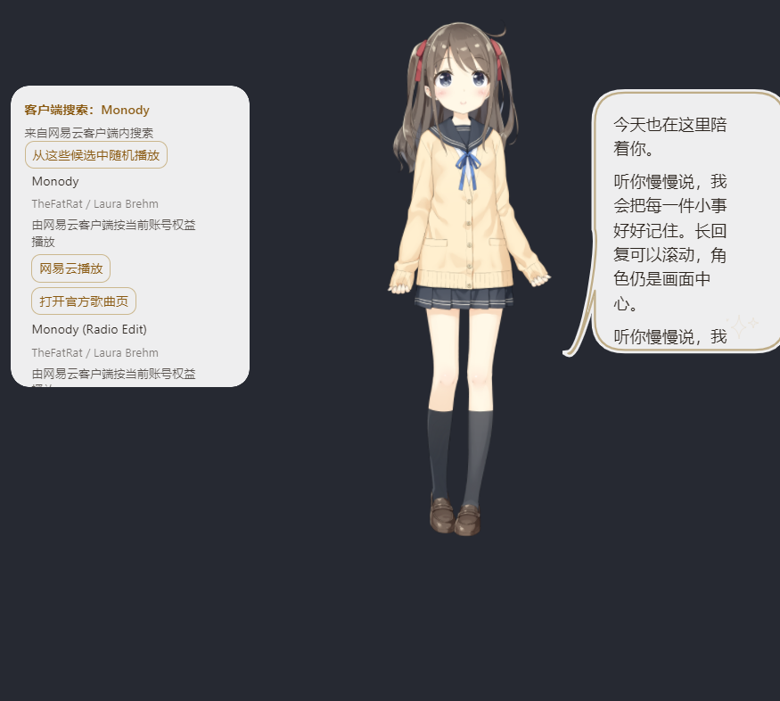
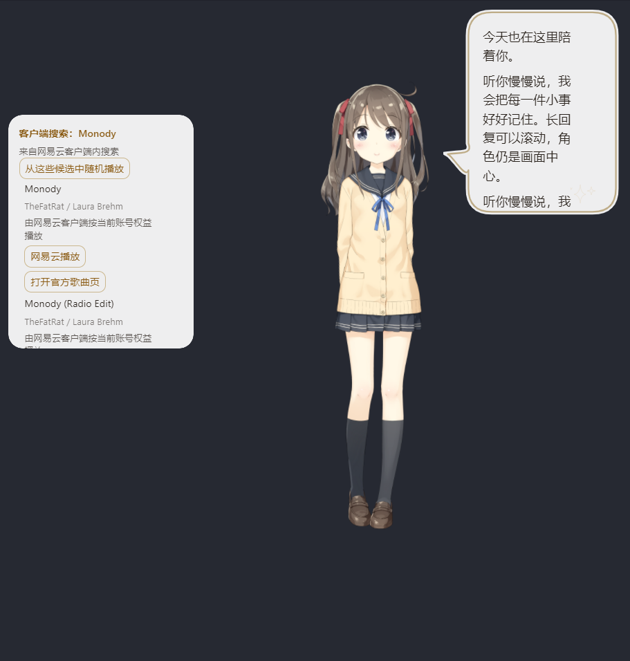
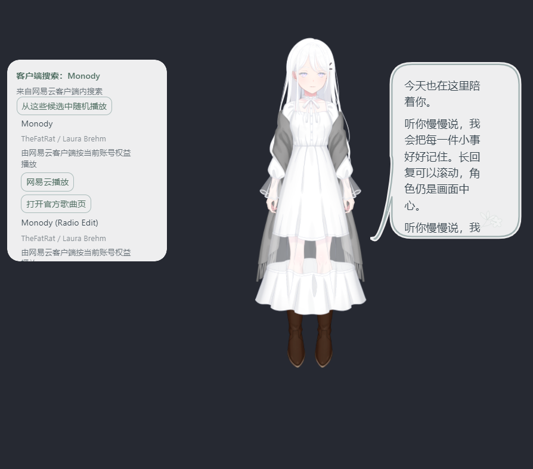
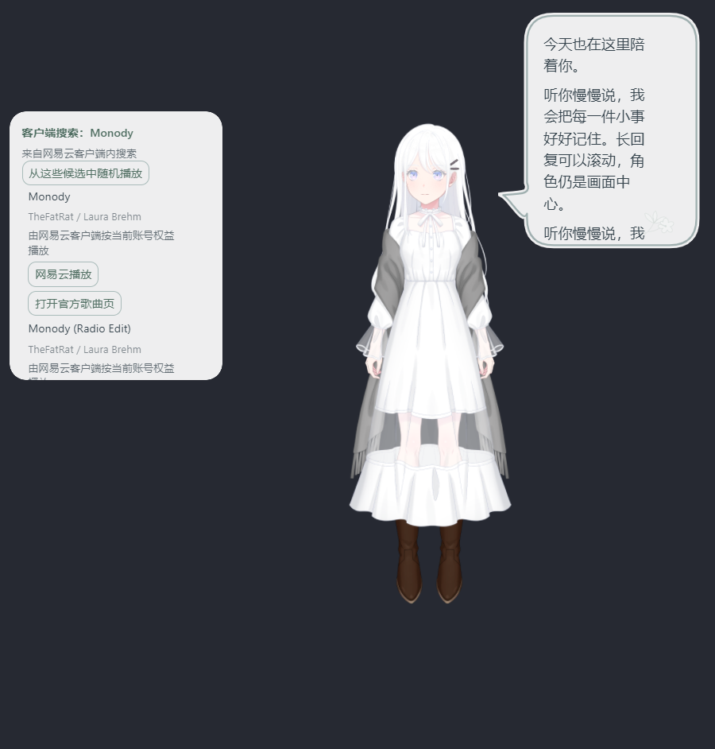

# 模型优先、贴近头部对白：双角色桌面验收

完成日期：2026-10-27（10-26开始验证，10-27完成收尾与正常保护核验）。延续现有Runtime与独立UI窗口，不进入G1。

## 目标与完成标准

- Goal：模型是画面主体，气泡/选歌卡更轻；对白靠近头部右上，保留清楚来源与安全距离。
- Scenario：Hiyori、Hotaru真实资源，长回复与真实客户端搜歌卡并存；移动到中央、右侧、右下、左上；切换后整套皮肤同步且旧结果清空。
- Architecture Increment：表现层的头部锚点、Alpha包络避让、模型优先预设和尺寸回报幂等；不改Agent/语音/记忆/播放器架构。
- Tests：原生Windows坐标与桌面截图、现有Alpha遮罩逐像素检查、前端生产代码单测与类型/构建；捕获保护通过系统API读回。
- DoD：可见模型像素无覆盖、模型完整可见、各面板不互相重叠且不越工作区、换肤一致；测试后清空样本，保留模型优先偏好，撤掉背景并恢复捕获保护。

## 最终调整

### 模型优先预设

调试台UI页新增“**模型优先 · 头部对白预设**”：根据屏幕可用高度设较大的模型窗口与约0.96填充，垂直居中，避免旧1.1填充造成的头部裁切；已有模型首次贴合、操作系统工作区夹紧仍会归一化最终窗口尺寸。保持等比缩放，不拉宽角色。

对白主体宽约176 DIP，加22 DIP短尖尾，14 DIP字号、10 DIP内边距、1.5行高、220 DIP内容高度；选歌卡约206 DIP、11 DIP字号、260 DIP最大高度、紧凑行距。显示偏好仍可热更新，原漫画/单曲线预设保留。成功后保留本预设，没有覆盖角色脑/声音/人设配置。

### 贴近头部且不遮挡

- 静态资源锚点向头部校准：Hiyori `mouthY=.22`，Hotaru `.28`；这不是逐帧嘴部追踪。
- 白框按头部锚点放置在右上方，SVG尖尾高度跟随头部屏幕位置，长文变高也不会让尾尖自然沉到脚边。
- 旧模型矩形包含透明资源留白。现复用现有低分辨率Alpha遮罩，按16段保守包络避让；对白窗可进入透明留白，不能覆盖可见角色。阈值4，包络额外4 DIP余量，另保留窗口间距。
- 不增加GPU读回；遮罩相同时复用投影缓存。无有效遮罩或收到不合法包络时回退整块矩形保护。
- 优先右侧靠近头部；空间不足可换侧/移位。**不保证屏幕极窄时仍固定右上**，也不以盖住模型换取固定位置。
- 源卡/音乐卡沿用保守模型矩形保护；面板之间仍互相避让。

## 发现并局部修正的问题

1. **模型放大后出现高频布局更新**：相同key、相同尺寸的回报仍无条件触发布局。加入幂等过滤；生产协调器的重复测量测试和多轮实际窗口移动通过，不再出现本轮最初的无响应。
2. **“不遮挡”但离头部仍远**：整张资源包围盒的透明留白拉开了距离。改用既有Alpha包络，核验标准从整块矩形改为可见像素不相交。
3. **主窗保护恢复不完整**：首次正常重启时，独立回复/卡窗保护为0x11，但模型主窗曾读到0。主窗显示、加载完成、切换鼠标穿透后重申保护。最终在三类实际窗口读到0x11，且穿透/交互切换后保持。

## 真实桌面结果

长回复为明确标注的**本地排版样本**；选歌卡来自真实客户端 `/搜歌 Monody`，没有伪造搜索提供商，也没有播放或改收藏。本轮不是麦克风ASR/TTS听感或LLM长文验收。

| 指标 | Hiyori | Hotaru |
|---|---:|---:|
| 基线模型高度（原生像素） | 639.3 | 683.6 |
| 模型优先后高度 | 716.5 | 748.0 |
| 高度增加 | 12.1% | 9.4% |
| 长回复窗高度 | 307 | 307 |
| 模型高度 / 长回复窗高度 | 2.33 | 2.44 |
| 中央/右侧/右下/左上 | 全部通过 | 全部通过 |
| 长文滚动、卡片并存 | 通过 | 通过 |
| 可见Alpha像素被窗口覆盖 | 0（采样时） | 0（采样时） |
| 调试台/模型窗/结果卡皮肤 | cream一致 | lily一致 |

坐标为本轮Windows原生窗口测量，不与DIP设置值混用。验收覆盖当前显示器、资源、缩放与采样时刻，不宣称所有显示器和任意极端动作都无需复测；动画极端外扩时仍受遮罩采样频率限制。

原生移动验证面板跟随，没有把`SetWindowPos`写成“人工鼠标拖拽已测”。靠边时优先保证工作区内和不遮挡，必要时卡片换侧或堆叠。角色切换后旧回复、选歌卡和播放归属清空；皮肤依次恢复正确映射。

## 前后对照截图

下图是**真实原生窗口的桌面截图**，临时中性背景只用于隔离无关工作内容，并非把图片重排成UI。前图为旧窗口几何的可重复复现（`446×586 / fillRatio=1.1 / yOffset=.45`，关闭头部跟随）；UI仍使用本轮共用偏好，**不是完整历史版本回放**。后图为本次最终布局。

| 角色 | 基线几何/未跟随头部 | 模型优先/头部对白 |
|---|---|---|
| Hiyori |  |  |
| Hotaru |  |  |

边缘截图：

- Hiyori：[右侧](model-first-artifacts/hiyori-right.png)、[右下](model-first-artifacts/hiyori-bottom-right.png)、[左上](model-first-artifacts/hiyori-top-left.png)。
- Hotaru：[右侧](model-first-artifacts/hotaru-right.png)、[右下](model-first-artifacts/hotaru-bottom-right.png)、[左上](model-first-artifacts/hotaru-top-left.png)。

## 检查与清理

- `scripts/diag/model_first_desktop_acceptance.py`：两角色8个最终位置场景，完成标记与切换清理通过，见 [desktop.json](model-first-artifacts/desktop.json)。
- `ui_appearance_test.cjs`：有界偏好、连续轮廓、保守Alpha包络覆盖、缓存与透明留白靠近通过。
- `detached_frontend_test.cjs`：48个边缘/负坐标场景、协调器sender/key隔离、重复测量稳定性、音乐控制隔离通过。
- `pnpm typecheck`、`pnpm build`通过。本轮生产代码只改壳层，没有把上轮后端924项结果当作本轮重新运行。
- 截图用`YUIRO_UI_CAPTURE=1`且仅开发态允许关闭保护，打包态仍保持保护。
- 临时WinForms背景进程已撤掉。正常环境不带截图开关重新启动壳。
- 三类窗口`GetWindowDisplayAffinity`均为 **17 / 0x11 / WDA_EXCLUDEFROMCAPTURE**；模型窗切换穿透与交互后也均为17，见 [正常保护核验](model-first-artifacts/normal-protection.json)。本地窗口样本已清空，没有测试音乐播放归属。
- 恢复测试前的活动角色，本轮最终为Hotaru/白花；保留用户要求的模型优先显示设置。正常启动后模型首次贴合会归一化窗口尺寸，最终有效值以保护核验文件内layout为准。

## 代码落点

- `shell/src/renderer/src/dev/components/DetachedUiSettings.vue`：模型优先预设、头部跟随选项。
- `shell/src/shared/{dialogueLine,mangaBubble,detachedUi}.ts`：资源锚点、尾尖高度、显示契约。
- `shell/src/renderer/src/utils/contourBands.ts`：复用已有遮罩的保守分段包络。
- `shell/src/main/{detachedLayout,detachedUi}.ts`：透明留白靠近、像素包络保护、尺寸回报幂等。
- `shell/src/main/index.ts`：正常主窗捕获保护在显示/穿透切换后的恢复。

保持现有点击穿透、渐隐和Runtime；不加入另一套渲染框架。
