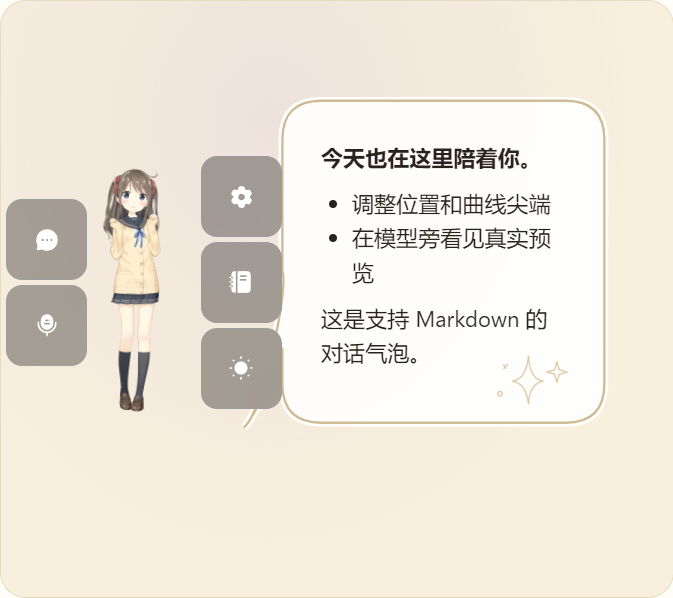
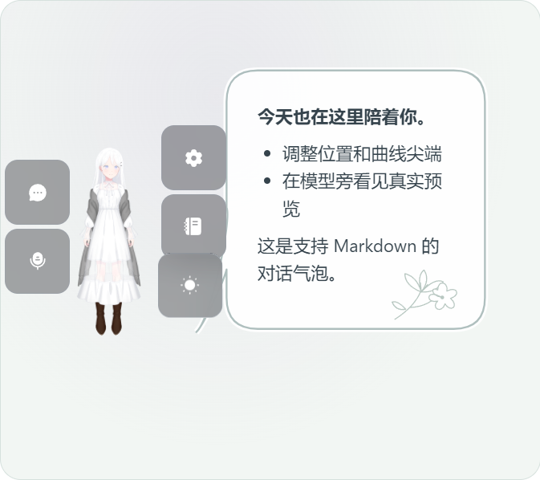

# Markdown、漫画气泡与网易云客户端入口（2026-10-26）

## 目标、场景与边界

目标：修复回复中的 Markdown；让音乐前端默认使用已验证的网易云客户端；移除已弃用形象；提高气泡和呼出菜单的调整自由度，并直接在调试台预览模型与气泡的关系。

场景：用户开启“当前模型与气泡的相对位置预览”，选择“试用漫画曲线预设”，调整尺寸/高度/尖端/功能岛，直接看结果；不必发送消息、调 LLM 或播放 TTS。实际回复继续显示在独立轻量窗口，不退回遮挡模型的内嵌面板。

本轮增量限于显示组件、当前音乐入口与工具可见性/执行约束；延续现有 Runtime、角色隔离、原生执行后端和取消协议。旧 API/mpv 代码保留。没有将 ncm-cli 完全替换，也没有写入用户的喜欢、歌单或账号资料。

## 已落地

1. 回复采用 `marked + DOMPurify` 的 Markdown 渲染，支持标题、强调、列表、引用、代码和表格；禁用图片/脚本/HTML 控件，链接只保留 HTTP(S)。普通文本仍可正常换行。预览点击不打开外链，真实回复链接经已有系统浏览器入口打开。TTS 输入不从渲染后的 HTML 取值。
2. 结果卡移除“桌宠播放器”按钮，行点击与“网易云播放”均走官方客户端的明确歌曲 ID。显示客户端权益说明，不再用 API 的不可播标志把原版变灰或归咎版权。增加“从这些候选中随机播放”，仅从当前卡片的有效 ID 里选一首，不冒充平台推荐。
3. 日常文本/语音链路禁用旧 `netease_play / netease_control / netease_recommend / netease_library`；搜索、歌单和歌词元数据保留。提示词每轮说明当前界面能力，禁用工具在预路由和执行侧均受约束，防止只隐藏 schema 而仍执行旧播放器。
4. 明确的“暂停/停止播放/继续播放”等短句通过官方客户端现有角色归属处理；Stop 映射为暂停并如实提示。不控制其他角色/用户自行切换后的歌曲，不通过全局媒体键兜底。下一首/上一首/平台随机模式目前明确提示去客户端操作，不宣称已执行。
5. 肥牛与 Mao Pro 从注册表隐藏；形象列表还核对真实扫描结果，已不存在的注册资源不再显示为可选项。Hiyori / Hotaru 及扩展模型扫描机制保留。
6. 气泡新增漫画曲线尖端、相对模型的说话高度、描边；宽度扩至 100–720 px、字号 10–36 px、高度 80–900 px、行距 1–2.5、圆角 0–100 px、内边距 4–48 px、透明度 0.05–1、偏移 ±1000 px。屏幕避让仍优先，范围大不代表允许压住模型。
7. 功能岛新增按钮大小、展开距离、间距、透明度、圆角、上下偏移和动画时长；保留原来的呼出方式，不恢复常驻“⋮”。菜单参数可热更新并在预览中演示。
8. 回复和结果卡改为细滚动条，空闲时透明，悬停/键盘聚焦时显现；保留鼠标滚轮和键盘滚动。

入口：**调试台 → UI → 独立回复与结果面板**。曲线预设需要用户点击应用，不将测试字号/主题强行留给用户。

## 网易云直达播放机制与能力边界

当前桥接复用 `native/ops.py` 的官方程序定位与协议投递：数字歌曲 ID 被编码进 `orpheus://` 命令，通过已注册的 `cloudmusic.exe --webcmd` 投递。官方客户端完成登录、权益判断与音频播放；Yuiro 不取歌曲音频直链。

确认播放不只看命令投递成功：固定的本机状态适配器读回当前歌曲 ID、时长/试听标志，再结合 SMTC 状态验证。9223 状态端口核对回环地址和实际 exe 所属进程；仅有固定的当前曲目投影，不读取账号凭证或开放任意脚本接口。曲目与角色/会话/播放归属绑定，防止切换后误控其他歌曲。源码依据：`engine/yuiro/native/netease_client.py`、`native/ops.py`、`netease/official_client.py`；前轮实际播放证据见 [精确 ID 验收](netease-exact-client-selection.md)。这属于当前已验证客户端版本的适配，不等于公开、长期稳定的官方 SDK。

**能替换播放通道，不等于已经替换全部数据能力。** 当前 `netease_search / playlist / lyric` 仍从既有开放平台授权获取元数据，仍可能需要 ncm-cli 登录态。完全移除它会同时失去现有候选搜索/歌单资料能力。网易公开的 [Agent Skills](https://github.com/NetEase/skills) 本身也依赖 ncm-cli 与开放平台配置，并不能作为“不依赖 API 的 Windows 客户端收藏/推荐桥接”依据。

| 操作 | 当前状态 | 下一步依据 |
|---|---|---|
| 指定歌曲 ID、暂停/继续、状态核验 | 已实现，复用已验证桥接 | 保持按 ID 回读、归属和取消回归 |
| 当前候选中随机播放 | 本轮前端加入 | 显式点选触发，不更换所选版本/播放器 |
| 根据心情推荐若干候选 | 可让 Agent 检索后建议，仍用现有元数据 | 不称为平台每日推荐/私人 FM |
| 官方客户端内搜索、读取候选 | 尚未替换元数据通道 | 先验证客户端可稳定读取 ID/标题/歌手，不能凭协议猜测 |
| 加入/取消喜欢 | 客户端桥接未接入；旧 API 实现保留但日常禁用 | 需要当前 ID 核对、写前/写后状态与失败不重复切换 |
| 私人 FM、心动模式、播放模式、歌单写入 | 未经当前桥接验证 | 每项单独检测能力，不由提示词强行宣称支持 |

## 验收

- 后端全量 **907 passed / 64.19 s**；最后补充短控制句的状态回执校验后，桥接相关 **22 passed** 复验。
- TypeScript 类型检查和生产构建通过；原有轮廓、角色取消、独立窗口、UI 偏好/计时器 Node 检查通过。
- `scripts/diag/ui_comic_acceptance.py` 在真实 Hiyori / Hotaru 模型和 Electron 窗口上验证：Markdown 强调和列表、恶意标签/链接清理、曲线显示、640 px 宽/32 px 字号热更新、不覆盖模型、预览不改变真实宠物窗口、62 px 功能岛按钮、前端仅客户端入口、随机按钮在安全预览中不执行真实播放。回执见 [live.json](ui-comic-artifacts/live.json)。
- 原来的 `ui_customization_acceptance.py` 再次通过：普通圆角、主题、持久化、重载、卸载后同步、分组重置与双角色清理。标准圆角测试临时关闭漫画形状，结束恢复原偏好。
- 本轮使用明确的本地显示样本测试排版，没有伪造服务商，也没有将样本发送至聊天/记忆/TTS；没有再次播放歌曲或修改账户收藏。音乐真实播放证据沿用上方前轮报告，本轮只验证新入口路由与执行边界。

最终已加载更新后的壳与引擎，恢复进入本轮时的 Hotaru；测试回复/结果均清空，调试台配置身份重新读回，与重启后的角色 revision 对齐。状态摘要见 [final.json](ui-comic-artifacts/final.json)。

预览截图（实际 Live2D 资源；功能岛使用放大的测试参数）：

## 后续可执行任务

1. **去掉元数据 CLI 依赖的前置验证**：在 NativeBackend 内验证官方客户端搜索入口和只读结果投影；同一查询核对至少 5 条结果的 ID/标题/歌手及原版/Remix 区分。失败保留候选页并提示，不静默回退到旧取流播放。没有稳定读回就不切换现有数据源。
2. **喜欢/取消喜欢**：仅在上述 ID 与当前曲目状态稳定后加入。接口使用目标状态 `liked=true/false`，已满足则不点击；写后读回确认。网络超时/未知结果不重复 toggle；旧角色请求无效，未匹配当前 ID 绝不操作。真实账号写入需用户明确发起，测试与普通 UI 预览分开。
3. **个性化推荐**：先把“当前候选随机”“角色偏好检索”“平台每日推荐/私人 FM”拆清来源。在现有角色配置边界保存偏好；平台推荐只有客户端能力可稳定验证时才展示为可用。验收包含角色切换和不重复推荐，不能只验一次能播放。
4. **演出细化**：当前曲线在气泡自身的独立窗口内，朝向模型一侧；尚未根据脸/口部语义锚点逐帧伸缩，也不是跨多个原生窗口的连续矢量线。下一步可在保持透明命中/避让的前提下独立验证语义锚点、曲线稳定性和多屏 DPI；不要为此重写现有 Runtime。

技术过程见 [复盘](../tech_review/2026-10-26-comic-ui-and-music-boundary.md)。
