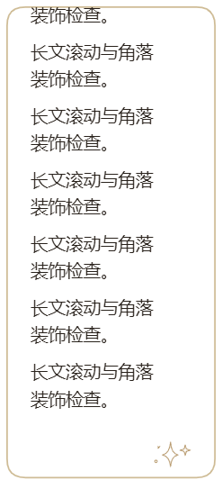
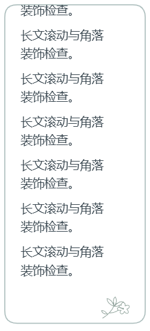

# 窗口高度、聊天坞高度与气泡角落装饰修复

日期：2026-10-27。仅修改壳层表现/几何和调试台，不改Runtime或角色配置。

## 目标与行为

- Goal：能实际增大模型窗口高度；聊天坞输入条高度可调；星光/白花在短文和长文中都可见。
- Scenario：调试台改窗口高度并确认读回；打开聊天坞调整高度；长文滚动后角花仍停留在独立角落位置。
- Architecture Increment：保留现有主进程DIP几何真相源、存储偏好与SVG装饰，局部修正限制和布局。
- Tests：真实Electron窗口/调试台输入事件、实际模型尺寸、两套角花截图、原有前端检查与构建。
- DoD：手调值不被首次贴合覆盖，反复读取不漂移；聊天坞热更新；装饰可见/可关闭且不与滚动正文重叠。

## 修复

### 窗口高度

旧工作区限制是宽/高各最多90%，到上限后滑杆被夹回，用户看到“不能再调高”。现在只保留8 DIP边距，仍不超出所在屏幕工作区。手调窗口增大时同步把位置约束回工作区，避免向下长出屏幕。

首次模型自动贴合不再覆盖已保存或已手调的窗口尺寸。高度滑杆上限与主进程一致为2000，并新增数值输入。读取布局时直接返回已夹紧的DIP设置，不用原生分数DPI取整值反写，避免多次读写后宽高发生漂移。

模型依旧等比适配：只拉高窗口时，模型还可能被窗口宽度限制。UI已补说明，可使用现有“锁定窗口比例”联动宽高。不通过拉伸角色或取消屏幕边界来放大。

### 聊天坞高度

UI → 聊天坞 → **输入条高度**，范围36–80 DIP，默认44。跨窗热更新、本地持久化，“恢复默认”包含高度。麦克风/发送按钮继续居中。

聊天坞变高时，模型布局按需增加底部预留，避免输入条盖住模型；语音提示仍在输入条下方展开。不改变语音/播放逻辑。

### 角落元素

原角花SVG存在，但浅色线条叠加0.22透明度，在白底下不明显；它也位于正文背景层，长文滚动时会和内容重叠。

现将装饰放入独立34 DIP页脚，使用当前皮肤强调色和更清晰笔触；默认不透明度0.6，并提供“角落装饰不透明度”滑杆。内容滚动区相应缩减，总面板最大高度保持克制；角花不随正文滚走，不占交互命中。关闭角花时页脚也移除，无背景单曲线仍不显示角花。

## 实机证据

`scripts/diag/height_corner_acceptance.py`，仅本地UI操作，不调用LLM、音乐、ASR或TTS。

| 检查 | 结果 |
|---|---|
| 请求窗口高度650 / 810 | 主进程读回650 / 810 |
| 对应实际模型布局高度 | 550 / 710 DIP |
| 手动设置后投递自动贴合请求 | 保持手调高度810 |
| 连续读取布局10次 | 一致，无宽高漂移 |
| 聊天坞高度36 / 80 | DOM实测约35.53 / 79.53（分数DPI取整，误差<1） |
| 奶油/白花装饰 | 两套均可见，实际alpha=0.6 |
| 长文滚动 | 角花页脚始终在内容区下方 |
| 关闭装饰 | 页脚移除 |
| 模型捕获保护 | 仍为0x11 |

测试后保留用户要求的较大窗口（本机610×810 DIP），其他临时角花/皮肤/聊天坞参数和聊天面板开关恢复原值。原生窗口物理像素受DPI量化影响，主进程设置值是DIP，不能把两个值混算。

[原始观测](height-and-corner-artifacts/live.json)

奶油星光：

白花：

## 回归

`pnpm typecheck`、`pnpm build`通过；`ui_appearance_test.cjs`的新增聊天坞高度存储/样式边界/恢复默认与装饰透明度检查通过；`detached_frontend_test.cjs`的布局/事件归属/头部指向稳定性通过。未重跑不涉及的后端全量测试。

主要文件：`main/index.ts`、`useChatDockPref.ts`、`App.vue`、`Live2DCanvas.vue`、`DevApp.vue`、`uiAppearance.ts`、`ReplySurface.vue`、`CharacterMotif.vue`、`DetachedUiSettings.vue`。
